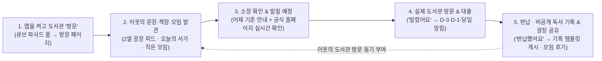

# 동네한권 (localone)

> **"도서관에 갈 사람만 쓰는 앱이 아니라, 앱을 열다 보면 동네 도서관에 가고 싶어지게 만드는 지역 독서 커뮤니티"**

### 🌐 배포 서비스 바로가기

- **웹 서비스:** https://localone-web-514256967550.asia-northeast3.run.app/
- **모바일 접속 QR 코드:**


---

동네한권은 공공 도서관을 차가운 행정·재고 조회 창구가 아닌 **동네 사람이 오가고 이야기가 쌓이는 살아있는 공간**으로 경험하게 만드는 서비스입니다.
내 주변 도서관을 입체 큐브 파사드로 보여주는 홈 화면에서 도서관을 눌러 **방문 페이지**로 들어가면, 그 도서관을 오가는 이웃들이 남긴 **핀터레스트형 2열 광장 피드(직접 찍은 사진 · 책 표지 · 단색 배경 위 좋은 문장)**와 **오늘의 서가(책장) · 방명록 · 작은 모임**을 만나며 다음 읽을 책을 발견합니다. 마음에 꽂히는 문장을 발견하면 가까운 도서관의 소장·대출 가능 여부(어제 기준)를 바로 확인해 **빌릴 예정**에 담고, 실제로 도서관에 들러 책을 빌린 뒤엔 **"빌렸어요"** 버튼 한 번으로 D-day 타이머와 반납 알림까지 가볍게 챙길 수 있습니다. 완독 후에는 나만의 비공개 **독서 기록**에 감상을 남기고, 좋은 구절을 템플릿 카드로 꾸며 다시 동네 도서관 광장에 공유합니다.

## 1. 왜 '단순 도서 대출/반납 시스템'이 아닌가요? (프로젝트 목적성과 방향성 전환)

최초 프로젝트 주제 목록에 흔히 등장하는 **도서 대출/반납 관리 시스템(단순 CRUD·장서 관리)**은 치명적인 한계를 안고 있습니다.
1. **실사용자를 구할 수 없는 '죽은 시스템'**: 실제 공공 도서관의 대출·반납 원장은 지자체 및 국립중앙도서관(책이음) 통합 DB에 독점되어 있어 외부 개인 앱이 대출 처리를 대행할 수 없습니다. 이미 책을 빌리러 도서관에 간 사람은 도서관 내 무인 대출기나 공식 지자체 앱을 쓰지, 제3의 대출 관리 앱을 설치할 이유가 없습니다.
2. **목적지가 정해진 사람만 쓰는 수동적 도구**: 기존 도서관 앱들은 *"이미 읽을 책을 정하고 도서관에 갈 결심을 마친 사람"*만 열어보는 검색기입니다. 읽을거리를 탐색하거나 동네 도서관에 발걸음을 옮길 **동기(Motivation)** 자체를 만들어주지 못합니다.

**동네한권의 역발상 (Paradigm Shift):**
> **"도서관에 갈 사람이 앱을 쓰는 게 아니라, 앱을 쓰다 보니 도서관에 가고 싶어지게 만들자."**

| 구분 | 기존 도서 대출/반납 시스템 (As-Is) | 동네한권 (To-Be) |
| :--- | :--- | :--- |
| **출발점** | 이미 읽을 책과 갈 도서관을 정한 상태 | 카페나 집에서 가볍게 이웃의 책 피드를 구경하는 상태 |
| **핵심 가치** | 행정 처리 및 대출 기한 관리 (유틸리티 중심) | **공간 방문 감각 + 이웃의 문장 발견 + 동네 작은 모임 (커뮤니티 중심)** |
| **사용자 행동** | 도서관 방문 → 책 대출 → 앱에 수동 기록 | **앱에서 도서관 '방문' → 이웃 문장에 공감 → 책 빌리러 실제 도서관행 → 독서 기록·재공유** |
| **시스템 생명력** | 대출할 때만 켜고 평소엔 방치되는 죽은 시스템 | 매일 도서관 광장에 새 문장·방명록·모임이 쌓이는 살아있는 생태계 |

### 무엇을 중심에 두고, 무엇을 덜어냈는가 ([00_기획_원본.md](개발산출물/00_기획_원본.md) · [01_프로젝트_기획서.md](개발산출물/01_프로젝트_기획서.md))

| 위계 | 영역 | 설계 의도와 특징 |
| :--- | :--- | :--- |
| **중심 1** | **도서관 '방문' 경험 (`library-visit`)** | 현재 위치 기점을 중심으로 주변 도서관을 **등각 큐브 파사드(20색 팔레트 · 2단 이름 표기)**로 배치하고, 전국 17개 시도 **1,624곳 공공 도서관**을 지역별로 자유롭게 탐색할 수 있습니다. 도서관을 누르면 바텀 시트가 아닌 **화면 전환 + 도서관별 고유 룩(모던 · warm · toffee · Oxford) + 방문 멘트 카드 + 방문 스탬프("다녀왔어요")**로 실제 도서관 문을 열고 들어온 듯한 공간감을 전달합니다. 자주 가는 도서관(3회 방문 시 제안 또는 `⋯` 메뉴 설정)은 앱을 켜자마자 바로 열립니다. |
| **중심 2** | **지역 독서 광장 SNS & 작은 모임 (`local-feed` · `book-club`)** | 도서관마다 열리는 **핀터레스트형 2열 메이슨리 피드**입니다. 목록 카드에는 제목·작성자·좋아요 수를 걷어내고 **오직 이미지(사진·책 표지·단색 9색)와 그 위의 문장만** 남겨 시선이 문장 자체에 머물게 합니다. 피드와 함께 **오늘의 서가(최근 반납 집계 · 도서관 인기 · 운영 테마 책장)**, **방명록 카드**, **회차별 작은 독서 모임**(즉시 참가·댓글 협의·종료 후기·알림함 `/inbox`), **신고·운영자 숨김**까지 하나의 도서관 공간 안에 연결됩니다. |
| **중심 3** | **개인 독서 기록 & 내 정보 (`reading-log` · `my-collection`)** | 혼자 조용히 쌓아가는 **비공개 독서 기록**(전체 보기 · 도서관별 내 발자취 · 기초 통계)을 남기고, 원할 때만 템플릿 카드로 꾸며 도서관 광장에 공개할 수 있습니다. 내 정보에서는 프로필 관리와 **내 게시물 · 좋아요 · 북마크(게시물+방문 기록 카드) · 도서관 방문 모음**을 한눈에 모아봅니다. |
| **보조** | **도서 탐색 & 반납 비서 (`book-search` · `loan-assistant`)** | 커뮤니티에서 생겨난 독서 욕구를 실제 도서관 방문으로 이어주는 다리입니다. **카카오 책 검색 API**와 **도서관 정보나루 API**를 결합해 내 주변(기본 3km, 설정 시 5km)부터 도시 전체 재검색까지 지원하며, 전날 기준 데이터를 정직하게 표기(`어제 기준 · 대출 가능`)하고 도서관 공식 홈페이지 **실시간 확인** 링크를 제공합니다. 책을 빌린 뒤에는 **"빌렸어요"** 한 번으로 D-day 타이머와 기기 로컬 알림(D-3 · D-1 · 당일)을 예약하고, 반납 시 동의한 익명 집계가 도서관 책장에 반영됩니다. |
| **원칙적 배제** | **과잉 엔지니어링 지양 (`안 함` 선언)** | 공공 API 상태 변화(Y→N)만으로 개인 대출을 추정·자동 등록하지 않으며, 가짜 도서관 회원증 바코드, 영수증 OCR, 무거운 서버 푸시 워커는 만들지 않습니다. 보조 기능이 중심 경험(방문·커뮤니티)보다 무거워지는 것을 엄격히 경계합니다. |

## 2. 책을 좋아하는 한 사람의 시선으로 본 사용 흐름 (Narrative User Journey)

> 화면 단위의 상세 분기, 예외 처리, 상태 전이 다이어그램은 [개발산출물/부록/유저_플로우.md](개발산출물/부록/유저_플로우.md)와 [개발산출물/02_요구사항_정의서.md](개발산출물/02_요구사항_정의서.md)에 정의되어 있습니다. 여기서는 **실제로 독서를 좋아하는 한 사람(지수)이 동네한권을 통해 어떻게 동네 도서관으로 발걸음을 옮기게 되는지** 그 여정을 따라갑니다.

### Step 1. 일요일 오후, 큐브 파사드 홈에서 동네 도서관에 '들어가다'
주말 오후 카페에 앉은 지수는 특별한 목적 없이 동네한권 앱을 켭니다. 홈 화면에는 복잡한 길 찾기 지도 대신, 현재 위치 기점을 중심으로 가장 가까운 도서관이 큼지막한 입체 큐브로 놓여 있고 주변 도서관 큐브들이 모서리에 이어지며 공간의 연속성을 보여줍니다(기점을 누르면 주변 도서관의 방향을 한눈에 보는 전체 보기가 열리고, 다른 지역 도서관도 17개 시도 목록에서 바로 고를 수 있습니다).
집에서 걸어서 15분 거리에 있는 도서관 큐브를 누르자, 팝업 대신 화면 전체가 그 도서관 고유의 **warm 톤 방문 페이지**로 전환됩니다. 상단에는 *"처음으로 ○○도서관에 방문했어요!"*라는 작은 멘트 카드가 반겨주고, 방문 스탬프("다녀왔어요")를 남기며 동네 도서관 로비에 발을 들인 듯한 기분을 느낍니다.

### Step 2. 도서관 광장에서 이웃의 문장, 오늘의 서가, 작은 모임을 만나다
방문 페이지의 **2열 메이슨리 피드**에는 같은 도서관을 오가는 동네 이웃들이 남긴 카드들이 책장처럼 놓여 있습니다. 지수의 눈길을 끈 것은 거창한 서평 제목이나 좋아요 숫자가 아니라, 직접 찍은 책 페이지 사진 위에 얹힌 짧은 한 문장이었습니다.
카드를 눌러 상세 화면을 열자 핀터레스트처럼 본문이 펼쳐지며 같은 책을 읽은 다른 이웃의 글로 자연스럽게 이어집니다. 피드 사이에는 이웃들의 **방명록 카드**와 **이번 주 작은 독서 모임** 카드가 보이고, 도서관 책장(**오늘의 서가**)에서는 최근 이 도서관에서 이웃들이 많이 읽고 반납한 책과 테마 도서를 한눈에 둘러볼 수 있습니다.

### Step 3. "우리 동네 도서관에 이 책이 있을까?" — 망설임 없는 발걸음
책을 읽고 싶어졌을 때 쇼핑몰 장바구니를 여는 대신, 게시물 상세 화면 바로 아래에 가장 먼저 자리 잡은 **대여(소장·대출 가능 조회)** 영역을 확인합니다(소장하고 싶은 책이라면 바로 아래 구매 링크로도 이어집니다).
방문 중인 이 도서관에 해당 책이 **소장 있음 · 어제 기준 대출 가능**으로 표시되는 것을 본 지수는, 헛걸음을 막기 위해 **실시간 확인** 버튼으로 해당 도서관 공식 홈페이지에서 당일 상태를 한 번 더 확인한 뒤 **빌릴 예정**에 담습니다. 주변 3km 도서관에 책이 없어도 **현재 도시 내 모든 도서관 기준 재검색**으로 시내 다른 도서관의 소장 여부를 즉시 찾아볼 수 있습니다.

### Step 4. 도서관 산책, 그리고 "빌렸어요" 한 번으로 끝나는 반납 비서
앱에서 얻은 영감 덕분에 지수는 산책 삼아 동네 도서관에 들러 실제로 책을 빌려 나옵니다. 도서관 문을 나서며 빌릴 예정 목록에서 **"빌렸어요"** 버튼을 가볍게 한 번 누릅니다.
복잡한 바코드 스캔이나 대출증 촬영 없이도 오늘(서울 날짜 기준)부터 14일 뒤로 반납 예정일 타이머가 돌아가기 시작하고, 기기에 **D-3 · D-1 · 반납 당일** 알림이 조용히 예약됩니다.

### Step 5. 완독 후 비공개 독서 기록과 광장 공유, 그리고 작은 모임으로 이어지다
열흘 뒤 책을 다 읽고 도서관에 반납한 지수는 **"반납했어요"**를 눌러 타이머를 멈춥니다(지수가 익명 집계에 동의했다면, 이 반납 기록은 개인 식별 정보 없이 도서관-책 단위로만 쌓여 도서관 책장의 **'요즘 사람들이 읽은 책'** 코너를 풍성하게 만듭니다).
이어서 지수는 나만의 비공개 **독서 기록** 탭에 솔직한 감상을 남기고(도서관별 내 발자취에도 차곡차곡 쌓입니다), 가장 좋았던 구절 하나를 골라 템플릿 카드로 꾸민 뒤 도서관 광장에 올립니다. 마음에 맞는 이웃들과는 **작은 모임**으로 한 회차 약속을 잡아 함께 이야기를 나누고, 모임 일정 확정·변경 소식은 앱 내 **알림함**에서 확인합니다.



## 3. 시장 배경 및 레퍼런스: 왜 지금 '지역 기반 독서 커뮤니티'인가?

동네한권의 기획은 단순한 아이디어가 아니라, **① 텍스트힙(Text Hip)과 함께 읽기 수요의 폭발**, **② 하이퍼로컬(동네) 커뮤니티의 일상화**, **③ 검증된 독서 커뮤니티 플랫폼들의 성장 사례**라는 세 가지 명확한 시장 데이터 위에 서 있습니다.

### 3.1 데이터가 증명하는 '함께 읽기'와 '동네 독서 모임' 수요 급증
- **2030 세대가 주도하는 '텍스트힙'과 교류형 독서**: 문화체육관광부 국민 독서실태 조사에 따르면 성인 전체 독서율은 40.3%로 낮아졌으나, **20대 독서율은 74.5%**에 달하며 독서를 개성 있는 취미이자 타인과 공유하는 문화로 소비하는 현상이 뚜렷해졌습니다([헤이팝 분석 기사](https://heypop.kr/n/131099/)). 혼자 읽는 것에 그치지 않고 감상을 나누며 가치관을 확인하는 '만남과 연결의 필터'로서 독서 커뮤니티가 주목받고 있습니다([중앙일보 비크닉](https://www.joongang.co.kr/newsletter/bicnic/18970)).
- **당근(Daangn) 동네생활 속 독서 모임 2.2배 급증**: 국내 대표 하이퍼로컬 플랫폼 당근의 발표에 따르면, 동네생활 게시판 내 **독서 모임을 열거나 제안하는 게시물 수가 전월 대비 2.2배(전년 동기 대비 52%) 급증**했으며, 관련 검색량 역시 50% 이상 상승했습니다. '도서·문학·글쓰기' 주제 게시물도 전월 대비 74% 늘어났습니다([당근 공식 보도자료](https://about.daangn.com/company/pr/archive/%EB%8B%B9%EA%B7%BC-%EB%8F%85%EC%84%9C-%EB%AA%A8%EC%9E%84-%EA%B2%8C%EC%8B%9C%EA%B8%80-2-2%EB%B0%B0-%EA%B8%89%EC%A6%9D-%EA%B4%80%EB%A0%A8-%EA%B2%80/), [지디넷코리아](https://zdnet.co.kr/view/?no=20241021195915)).
- **오프라인 지역 커뮤니티의 폭발적 성장**: 당근모임은 2024년 연간 가입자 수가 전년 대비 3배 증가하고 재참여율 62%를 기록한 데 이어([지디넷코리아 연말결산](https://zdnet.co.kr/view/?no=20241226082721)), **2026년 상반기 기준 월간활성사용자(MAU) 1,000만 명을 돌파**하며 모임 수 74%, 가입자 수 128%, 참여 후기 191% 증가라는 지표를 기록했습니다([매일경제](https://www.mk.co.kr/news/pick/12093189), [뉴시스](https://mobile.newsis.com/view/NISX20260708_0003700177)). 이는 사람들이 먼 곳이 아닌 **'내가 사는 동네' 안에서 취미와 지적 교류를 함께할 이웃을 찾고 있음**을 입증합니다.

### 3.2 핵심 벤치마킹 레퍼런스 및 동네한권의 포지셔닝

동네한권은 기존 독서 커뮤니티 서비스들의 성공 요인을 흡수하되, 이를 **'공공 도서관이라는 물리적 동네 거점'**과 결합하여 고유한 영역을 구축했습니다.

| 서비스 | 핵심 특징 및 시사점 | 동네한권(localone)에 반영한 설계 포인트 |
| :--- | :--- | :--- |
| **[그믐 (Gmeum)](https://www.gmeum.com/)** *(핵심 레퍼런스)* | 소설가 장강명과 김혜정 대표가 설립한 온라인 독서 지식공동체([한국독서교육신문](https://www.readingnews.kr/news/articleView.html?idxno=11398), [독서인 인터뷰](https://korearf.kpipa.or.kr/cop/bbs/selectArticleDetail.do?nttId=30753&bbsId=BBSMSTR_000000000105&pageIndex=1)). 친목 수다로 변질되는 것을 막기 위해 **29일 기한의 회차형 모임**을 운영하고, 비회원도 글을 읽을 수 있는 개방형 구조로 오픈 한 달 만에 50여 개 모임이 자생 개설됨. | - **책과 문장 중심의 느슨한 연대**: 팔로워 수·팔로워 목록을 노출하지 않고(과시형 인플루언서화 방지), 목록에서는 작성자 이름조차 숨긴 채 **이미지와 문장**만으로 소통(`LOCAL-03`, `C-46 F1`)<br/>- **회차 단위의 부담 없는 약속(`CLUB-01~02`)**: 영구적인 친목 클럽이 아니라 그믐처럼 **한 번 만나는 약속 단위 모임**으로 설계하고, 비로그인 방문자도 광장 피드를 모두 열람할 수 있게 개방(`USR-01`) |
| **[예스24 사락](https://www.dataeconomy.co.kr/news/articleView.html?idxno=30075)** | 도서 리뷰 및 독서모임 커뮤니티. 2024년 1020세대 도서 리뷰가 전년 대비 51.7% 증가(4만 4,652건)하고, 독서모임 오픈 6개월 만에 **1,600개 이상의 모임 개설**(2025년 1월 한 달간 502개 신설). 좋은 구절을 기록해 공유하는 **'책 영업'**과 **'느슨한 모임'** 트렌드 확인. | - **시각적 '책 영업' 피드와 대여·구매 연결**: 핀터레스트형 감성 카드와 기록 템플릿(`LOCAL-07`)으로 '책 영업' 경험을 극대화하고, 도서관 대여 조회 우선 제공 후 구매 링크로 연결(`LOCAL-04`) |
| **[플라이북 (Flybook)](https://www.flybook.kr/)** | 도서관 이용자 대상 맞춤 도서 추천 및 소셜 리딩 플랫폼([문화 빅데이터 플랫폼 사례](https://www.bigdata-culture.kr/bigdata/user/utilization/view.do?sq=26&board_code=utilization), [산업일보](https://kidd.co.kr/news/245439)). 책 추천과 도서관 대출 안내를 결합해 독서 장벽을 낮춤. | - **AI 추천 대신 '동네 이웃의 문장'과 '오늘의 서가'로 발견**: 차가운 알고리즘 추천 대신 같은 도서관을 쓰는 이웃의 피드, 반납 동의 익명 집계(`요즘 사람들이 읽은 책`), 공공 인기대출도서(`VISIT-04`)로 도서관 방문 맥락 강화 |
| **[트레바리](https://m.trevari.co.kr/) · [문토](https://www.joongang.co.kr/newsletter/bicnic/18970)** | 누적 15만 명 이상이 참여한 대표적 유료 독서·취향 모임 플랫폼([뉴스저널리즘](https://www.ngetnews.com/news/articleView.html?idxno=517891)). 책을 통한 깊이 있는 대화 수요를 증명했으나, 높은 참가 비용과 대도시 특정 거점 편중이라는 진입 장벽이 존재. | - **공공 도서관 거점의 무료·일상적 접근성**: 비싼 참가비나 먼 이동 없이, 누구나 걸어갈 수 있는 **우리 동네 공공 도서관**을 거점으로 삼아 심리적·경제적 진입 장벽을 해소 |

## 4. 질의응답(Q&A) 대비 핵심 논리 요약 (발표 및 점검용)

| 예상 질문 | 핵심 답변 요약 | 근거 문서 |
| :--- | :--- | :--- |
| **Q1. 왜 도서 대출/반납이 아니라 커뮤니티가 중심인가요?** | 공공 도서관 대출 원장은 외부 앱에 쓰기 권한이 열려 있지 않아 대출/반납만으로는 실사용자를 모을 수 없는 죽은 시스템이 됩니다. 반면 당근 동네생활 독서모임 2.2배 증가나 '그믐'·'사락' 사례처럼 **이웃과 책을 매개로 소통하려는 수요는 급증**하고 있습니다. 따라서 **"앱에서 이웃의 문장을 보고 도서관에 가고 싶어지게 만드는 것"**이 실질적인 가치를 창출합니다. | [00_기획_원본.md](개발산출물/00_기획_원본.md), 본문 §1·§3 |
| **Q2. 기존 독서 앱(그믐, 플라이북, 밀리의서재 등)과 무엇이 다른가요?** | 기존 독서 커뮤니티는 '전국 단위 온라인'에 머물러 오프라인 공간감이 없고, 지역 앱(당근)은 중고거래·일상 잡담 중심이라 책과 문장에만 집중하기 어렵습니다. 동네한권은 **내 주변 도서관을 '방문'하는 공간적 경험**과 **오직 이미지·문장만 남긴 핀터레스트형 도서관 광장 · 작은 모임**을 결합하고, 발견한 책을 **그 도서관에서 바로 빌릴 수 있는지(소장 조회 + 실시간 확인)**까지 원스톱으로 이어줍니다. | [01_프로젝트_기획서.md](개발산출물/01_프로젝트_기획서.md), [02_요구사항_정의서.md](개발산출물/02_요구사항_정의서.md) |
| **Q3. 공공 데이터(정보나루 API)가 실시간이 아닌데 대출 가능 여부를 어떻게 보장하나요?** | 실시간이라고 속이지 않는 것이 핵심 원칙입니다(`LIB-03`). 정보나루의 대출 가능 데이터는 전날 기준이므로 화면에 **`어제 기준 · 대출 가능`**처럼 기준일을 명확히 밝히고, 바로 옆에 **`실시간 확인` 버튼(`LIB-06`)**을 두어 해당 도서관의 공식 홈페이지로 즉시 연결합니다(전수 점검·보정을 거친 전국 1,624곳 도서관 홈페이지 반영). | [02_요구사항_정의서.md](개발산출물/02_요구사항_정의서.md), `LIB-03`, `LIB-06`, `Q-48` |
| **Q4. 바코드나 OCR 없이 "빌렸어요" 버튼만 두면 너무 단순하지 않나요?** | 의도된 단순화입니다(`C-11`). 공공 API 변화로 개인 대출을 자동 추정하면 오작동과 개인정보 문제가 발생하고, 영수증 OCR은 오히려 사용자 피로도를 높입니다. 반납 비서는 중심 경험(방문·커뮤니티)을 뒷받침하는 보조 기능이므로, **"빌렸어요" 한 번으로 서울 날짜 기준 D-day와 기기 로컬 알림(D-3·D-1·당일)을 정확히 예약**하는 데 집중했습니다. | [00_기획_원본.md](개발산출물/00_기획_원본.md), `LOAN-01~05` |

## 5. 최종 결과물 화면·기능 구성 (M1 + M2 전체 범위)

동네한권은 **하단 탭 4개**(`홈` / `독서 기록` / `대출·반납` / `내 정보`)를 축으로, M1(제한 파일럿)과 M2(공개 베타) 전체 기능이 유기적으로 연결된 단일 앱(iOS · Android · Web)으로 완성됩니다.

| 영역 (담당) | 주요 기능 및 화면 구성 |
| :--- | :--- |
| **홈 화면 (`library-visit`, A)** | - **등각 큐브 파사드 홈 (`VISIT-1`)**: 현재 위치 기점을 중심으로 주인공 도서관 큐브 + 주변 이웃 3곳 모서리 배치, 20색 팔레트(`CUBE_PALETTE`) 및 2단 이름 표기(`cubeNameRule`), 기점 클릭 시 주변 7곳 방향 전체 보기(`ringScene`)<br/>- **전국 도서관 탐색**: 17개 시도·시군구 선택(`RegionPicker`), 시 본청 코드 하위 구 도서관 합치기, 전국 1,624곳 공공 도서관 지원<br/>- **홈 하단 창 (`VISIT-1b`)**: 자주 방문하는 도서관의 피드 · 인기 도서 · 내 최근 독서 기록(`READ-2` 연결) |
| **도서관 방문 페이지 (`local-feed`, B)** | - **방문 틀 (`VISIT-2`)**: 화면 전환 · 도서관 정보 머리 · `⋯` 메뉴(도서관 기본값 설정) · 방문 멘트 카드<br/>- **2열 메이슨리 광장 피드 (`LOCAL-1~2`)**: 사진·책 표지·단색(9색+옛 6색 호환) 카드 작성(EXIF 위치 자동 제거), 즉시 공개/철회, 상세 이어 읽기, 공감·북마크·공유, 대여 조회 우선·구매 연결<br/>- **오늘의 서가 & 방명록 (`VISIT-3`)**: 책장(최근 30일 반납 집계 → 도서관/공통 운영 테마 → 도서관별 인기) · 한 칸짜리 방명록 카드<br/>- **스탬프 & 도서관 룩 (`VISIT-4`)**: "다녀왔어요" 방문 스탬프 기록·스탬프 북마크, 도서관별 고유 룩 4종(`modern` · `warm` · `toffee` · `oxford`)<br/>- **기록 템플릿 게시 & 신고 (`LOCAL-3~4`)**: 비공개 독서 기록을 템플릿 카드로 꾸며 광장에 게시, 게시물/방명록/댓글 신고 및 운영자 숨김 처리 |
| **독서 기록 (`reading-log`, A)** | - **비공개 기록 작성·조회 (`READ-1`)**: 본인만 열람하는 비공개 독서 기록(도서·감상·독서일·도서관·대출 선택 연결)<br/>- **전체 보기 · 도서관별 보기 · 통계 (`READ-2`)**: 전체 서재, 도서관별 보기(내 발자취 통합), 기초 독서 통계 및 홈 하단 창 "내 최근 독서 기록" 연동 |
| **도서 탐색 & 반납 비서 (`book-search` · `loan-assistant`, C)** | - **도서 검색·상세 (`LIB-1~3`)**: 카카오 책 검색 API 기반 검색, 추천 도서·최근 본 도서 20권, 정보나루 기반 주변 3km/5km 및 도시 전체 소장·대출 가능 조회(`어제 기준` + 공식 홈페이지 `실시간 확인`), 빌릴 예정 저장<br/>- **반납 비서 (`LOAN-1~3`)**: "빌렸어요" 원터치 등록, 서버 KST(`Asia/Seoul`) 기준 D-day 타이머, 기한 수정·반납 처리, 기기 로컬 알림(D-3·D-1·당일), 동의 시 익명 반납 집계 반영 |
| **작은 모임 & 알림함 (`book-club`, C)** | - **회차별 작은 모임 (`CLUB-1`)**: 도서관 기반 모임 개설(미정 일정 허용)·즉시 참가·댓글 협의·일정 확정/변경/취소(방문 페이지 피드 연동)<br/>- **종료·후기·출석·알림함 (`CLUB-2`)**: 모임 종료 안내, 비공개 후기, 다음 회차 모임 생성, 출석 확인·불참/댓글 기간제 제한, 앱 내 알림함 화면(`/inbox`) |
| **내 정보 (`my-collection`, A)** | - **내 정보 모음 (`MY-1`)**: 상단 프로필 + 3탭(`내 게시물` / `좋아요` / `북마크`)<br/>- **프로필 수정 & 알림 아이콘 (`MY-2`)**: 프로필 사진·닉네임·한 줄 소개 편집, 알림함(`/inbox`) 읽지 않음 배지 진입<br/>- **도서관 방문 모음 (`MY-3`)**: 내가 방문한 도서관 스탬프 모음 및 북마크 탭 방문 기록 카드 통합 |
| **계정 · 공통 기반 · 운영 (`core` · `auth`, D)** | - **인증·계정 (`AUTH-1~3`)**: Supabase Auth(Google · iOS Apple), 서버 JWKS(`ES256`/`RS256`) 검증, 로그아웃(철회 세션 거부·로컬 알림 정화), 회원 탈퇴(M1·M2 전체 테이블 순서별 정리)<br/>- **공공 데이터 엔진 & M2 공통 기반 (`LIB-0` · `SRV-0` · `APP-0` · `M2-0`)**: 정보나루·카카오 조회 엔진 및 전국 1,624곳 도서관 동기화·홈페이지 보정, 알림함 서버(`/inbox`), 운영자 화면(`/ops` — 숨김/복구/신고/제한/룩 재배정/서가 테마), 반납 집계 동의·쓰기 |

## 6. 기술 스택 및 저장소 구조

| 영역 | 스택 |
| :--- | :--- |
| **Backend** | Python 3.12, FastAPI, SQLAlchemy 2, psycopg 3, PostgreSQL(Supabase), Alembic, `uv` |
| **Auth** | Supabase Auth (Google · iOS Apple), 서버 JWKS(`ES256`/`RS256`) 검증 |
| **External APIs** | 도서관 정보나루 Open API(전국 1,624곳 도서관·소장/대출 가능·인기 도서), 카카오 책 검색 API |
| **Mobile / Web** | React Native, Expo SDK 58, expo-router, TypeScript, `react-native-web`, `react-native-svg` |
| **Deploy / CI** | Google Cloud Run (`localone-api`, `localone-web`), Docker Compose(로컬 격리 DB `postgres:17`), GitHub Actions (`CI ok` · iOS 시뮬레이터 빌드 · Android APK 빌드 점검) |

```text
localone/
├── 2lxLf.png                      # 배포 웹 서비스 URL QR 코드
├── DESIGN.md                      # 전체 화면 디자인 시스템 · 토큰 · 룩 4종 · 결정 기록
├── setup-team.sh                  # 비공개 기술 계약 체크아웃(선택)
├── scripts/
│   ├── deploy-web.sh              # 모바일 웹 빌드 · 번들 검사 · Cloud Run 배포 · CORS 연결
│   └── dev-reset-and-check.sh     # 로컬 개발 서버·DB·Metro 초기화 및 점검 스크립트
├── server/                        # FastAPI 백엔드 (`uv`, Alembic, pytest, Cloud Run Dockerfile)
├── mobile/                        # Expo 앱 (iOS · Android · Web 단일 코드베이스, deploy-web/)
├── docker-compose.yml             # 로컬 시험용 격리 PostgreSQL(포트 5433)
├── .github/workflows/ci.yml       # 서버 시험 · 앱 타입/웹 내보내기 · iOS/Android 빌드 점검
├── 계획/상용_서비스_계획.md        # Feature 순서 · M1/M2/M3 범위 · 마일스톤
├── 개발산출물/
│   ├── 00_기획_원본.md             # 기획 원문 추적 · 우선순위(중심/보조/안 함)
│   ├── 01_프로젝트_기획서.md       # 배경 · 문제 정의 · 목적 · 대상 사용자 요약
│   ├── 02_요구사항_정의서.md       # M1~M3 요구사항 · 수용 기준(AC)
│   ├── 05_ERD_및_DB설계서.md       # M1·M2 테이블 설계(선행 설계 원본)
│   ├── 06_기능_API_정의서.md       # M1·M2 엔드포인트 목록 · 공통 오류 코드
│   ├── 기준선.md                   # 계약 기준선 및 미결 현황
│   ├── 인수인계_메모.md            # PC·세션 간 최신 운영/개발 상태
│   ├── 작업일지.md                 # 작업자별 일일 개발 로그
│   ├── 부록/                       # 유저 플로우 · 와이어프레임 · 실기기 확인 · 갭 분석 등
│   └── 명세/ · 시안/ · 결과/ · 완료/ # D 결정 기록 · HTML 시안 · 검증 결과 · 완료 진행 문서
└── specs/<기능>/                  # 기능별 큰 틀 및 세부 명세서 · 시안 · 검증서(verify.md)
```

## 7. 프로젝트 운영과 AI 작업

프로젝트 소유자가 제품 결정과 작업 범위를 정합니다. 2026-11-24부터 사람 A·B·C·D 역할, 기능별 파일 소유권, 역할에 따른 승인·커밋 분리·자동 인계를 폐기했습니다. 작업에는 현재 사용자 지시와 해당 기능의 기술 기준을 적용합니다.

- 기능 작업은 **기획 → 계약 및 명세 작성 → 구현 → 주니어 AI 마무리** 순서로 진행합니다. 기획에서는 시안을 보며 세부사항을 묶어서 확인합니다. 계약과 명세는 함께 작성합니다. 구현에서 핵심 검증을 하고 주니어 AI가 남은 검증과 허용된 Git 작업을 마무리합니다. 단계마다 세션·브랜치·PR·승인을 별도로 만들 필요는 없습니다.
- 비공개 기술 계약이 필요한 경우 `sh setup-team.sh`로 옆 폴더에 체크아웃할 수 있습니다. 접근이 필요한 기술 근거가 없으면 해당 근거에 의존하는 변경만 보류합니다.
- 작업 전 브랜치·HEAD·status·diff를 확인하고 기존 변경을 보존합니다. 명세·계약·코드·검증 결과를 대조하고, 원격 게시·머지·배포는 사용자 지시 범위를 따릅니다.
