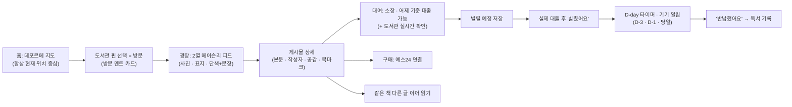

# 동네한권 (localone)

> **"내 주변 도서관에 '방문'하는 느낌으로, 이웃의 독서 이야기에서 다음 책을 만나고 빌리는 책까지 챙기는 지역 독서 커뮤니티"**

동네한권은 공공 도서관을 단순히 책 검색 창구가 아니라 **동네 사람이 오가고 이야기가 쌓이는 공간**으로 경험하게 만드는 서비스입니다.
지도에서 내 주변 도서관을 골라 **방문 페이지**로 들어가면, 그 도서관을 이용하는 이웃들이 남긴 **핀터레스트형 2열 피드(사진 · 책 표지 · 좋은 문장)**를 구경하며 다음 읽을 책을 발견합니다. 마음에 드는 책을 찾으면 가까운 도서관의 소장·대출 가능 여부(어제 기준)를 확인해 **빌릴 예정**에 담고, 실제로 빌린 뒤엔 **"빌렸어요"** 한 번으로 D-day 타이머와 반납 알림까지 챙길 수 있습니다.

---

## 왜 동네한권인가요? (기획의 중심과 매력)

| 구분 | 핵심 경험 | 특징 |
| :--- | :--- | :--- |
| **중심 · 도서관 방문** | 미니멀 데포르메 지도에서 핀을 눌러 **도서관 방문 페이지**로 진입 | 장황한 연출 대신 화면 전환 + 배경·헤더 변화 + 첫 방문/연속 방문 **방문 멘트 카드**로 "도서관에 들어온 느낌" 전달. 자주 가는 한 곳은 **도서관 기본값**으로 바로 열기 |
| **중심 · 지역 독서 SNS** | 도서관별 **2열 메이슨리 광장 피드** & 핀터레스트형 상세 | 카드에는 제목·작성자·공감 수 없이 **이미지와 문장만** 깔끔하게 노출. 상세에서 같은 책을 다룬 **다른 이웃의 글 이어 읽기**, 대여(소장 조회) 우선 · 구매(예스24) 연결 |
| **보조 · 도서 탐색 & 반납 비서** | 내 주변(3km/5km)·도시 전체 검색 + **"빌렸어요" 한 번**의 D-day 관리 | 공공 데이터는 `있음/없음/알 수 없음` 및 **데이터 기준일(어제 기준)**을 정직하게 표기하고 도서관 사이트 **실시간 확인**으로 연결. 대출은 자동 추정 없이 사용자가 직접 시작해 기기 로컬 알림(D-3·D-1·당일) 제공 |

> **하지 않는 것 (원칙):** 공공 데이터 변화만으로 대출을 추정·자동 등록하지 않습니다. 도서관 회원증 바코드, 영수증 OCR, 서버 푸시는 만들지 않습니다.

---

## 전체 사용 흐름 (User Flow)



### 화면·기능 구성 (M1 기준)
- **하단 탭 4개**: `홈(지도)` / `독서 기록` / `대출·반납` / `내 정보` *(글쓰기는 하단 탭이 아닌 피드 안의 버튼)*
- **도서관 방문 (`library-visit`)**: 카카오맵 기반 데포르메 지도, 위치 미허용 시 임시 시작 위치 + 위치 허용 버튼, 지도 내 책 검색과 "도서관 찾기" 버튼 분리
- **지역 SNS (`local-feed`)**: 사진·표지·단색 이미지 + 문장 올리기(제목·본문 없이 이미지만도 게시 가능, EXIF 위치 제거), 공개/철회, 공감·북마크·공유 메뉴
- **도서 탐색 (`book-search`) & 반납 비서 (`loan-assistant`)**: 검색 진입 화면(추천/인기 도서·최근 본 도서), 내 주변 3km/5km 및 도시 전체 재검색, 서버 KST 날짜 기준 D-day 관리

---

## 현재 진행 상태 (기준선 `B1`, 2026-11-13)

- **인프라·실행 뼈대 (`INIT`)**: `server/`(FastAPI, `/api/v1/ready`, CORS, 테스트 18건) · `mobile/`(Expo SDK 58, 웹 출력 포함) · GitHub Actions CI(`CI ok` + `main` 보호 ruleset) 구축 완료
- **제품 설계·기준선 (`B0` → `B1`)**: M1 요구사항 29개 확정, 선행 설계 원본([05_ERD_및_DB설계서.md](개발산출물/05_ERD_및_DB설계서.md) 14개 테이블 · [06_기능_API_정의서.md](개발산출물/06_기능_API_정의서.md) 30개 엔드포인트) 확정, `AUTH-1`(Supabase Auth + JWKS 검증) 계약 및 로그인 시안 확정
- **기능별 기획 현황 (큰 틀 3건 모두 `main` 머지 완료 → 세부 명세 단계 진행 중)**:
  - `library-visit` (A): 큰 틀 머지(PR #2 + D 결정 반영) → `VISIT-1` 세부 명세·시안 진행 중
  - `local-feed` (B): 큰 틀 머지(PR #50 + D 결정 반영) → `LOCAL-1` 세부 명세·시안 진행 중
  - `book-search` (C): 큰 틀 머지(PR #17) → `LIB-1` 세부 명세(PR #48 Draft) 진행 중
  - `auth` (D): B1 계약 확정 완료 → `AUTH-1-P1` 구현 착수 단계

---

## 기술 스택 및 저장소 구조

| 영역 | 스택 |
| :--- | :--- |
| **Backend** | Python 3.12, FastAPI, SQLAlchemy 2, psycopg 3, PostgreSQL(Supabase), Alembic(도입 예정), `uv` |
| **Auth** | Supabase Auth (Google · iOS Apple), 서버 JWKS(`ES256`/`RS256`) 검증 |
| **Mobile / Web** | React Native, Expo SDK 58, expo-router, TypeScript, `react-native-web` |
| **Infra / CI** | Docker Compose(로컬 격리 DB `postgres:17`), GitHub Actions (`CI ok`, iOS 시뮬레이터 빌드 점검) |

```text
localone/
├── setup-team.sh                 # 팀 규칙 설치 스크립트(조직 멤버 전용)
├── server/                       # FastAPI 백엔드 (`uv`, pytest)
├── mobile/                       # Expo 앱 (iOS · Android · Web 단일 코드베이스)
├── docker-compose.yml            # 로컬 시험용 격리 PostgreSQL(포트 5433)
├── .github/workflows/ci.yml      # 서버 시험 · 앱 타입/웹 내보내기 · iOS 빌드 점검
├── 계획/상용_서비스_계획.md       # Feature 순서 · M1 동결 범위 · 마일스톤
├── 개발산출물/
│   ├── 00_기획_원본.md            # 기획 원문 추적 · 우선순위(중심/보조/안 함)
│   ├── 02_요구사항_정의서.md      # M1~M3 요구사항(29개 M1) · 수용 기준(AC)
│   ├── 05_ERD_및_DB설계서.md      # M1 테이블 골격(선행 설계 원본)
│   ├── 06_기능_API_정의서.md      # M1 엔드포인트 목록 · 공통 오류 코드
│   ├── 기준선.md                  # 현재 계약 기준선(B0/B1) 및 미결 현황
│   ├── 유저_플로우.md             # 전체 순환 여정 · 기능별 흐름도
│   └── 명세/ · 시안/ · 결과/      # D 결정 기록 · HTML 시안 · 검증 결과
└── specs/<기능>/                 # 기능별 큰 틀 및 세부 명세서 · 시안
```

---

## 팀 작업 방식

조직(`axteamc`) 멤버가 1인 1기능 풀스택(화면 + API + DB) 수직 소유로 개발하며, 각자 AI(Claude Code 등)와 협업합니다. 작업 규칙과 계약서는 비공개 저장소(`axteamc/team`)에서 관리하며, 이 공개 저장소에는 `CLAUDE.md`·`.claude/`를 커밋하지 않습니다.

- 멤버는 저장소를 clone한 뒤 `sh setup-team.sh`를 실행하면 옆 폴더(`../team`)와 로컬 규칙이 설정됩니다.
- 모든 기능은 **큰 틀 명세 → 세부 명세 + HTML 시안 → D 검토·머지 → 계약서 → 구현(PR)** 순서로 진행합니다.
