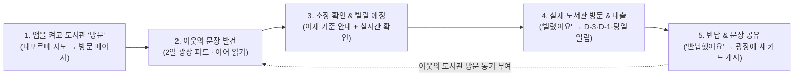

# 동네한권 (localone)

> **"도서관에 갈 사람만 쓰는 앱이 아니라, 앱을 열다 보면 동네 도서관에 가고 싶어지게 만드는 지역 독서 커뮤니티"**

동네한권은 공공 도서관을 차가운 행정·재고 조회 창구가 아닌 **동네 사람이 오가고 이야기가 쌓이는 살아있는 공간**으로 경험하게 만드는 서비스입니다.
미니멀 데포르메 지도에서 내 주변 도서관 핀을 눌러 **방문 페이지**로 들어가면, 그 도서관을 오가는 이웃들이 남긴 **핀터레스트형 2열 광장 피드(직접 찍은 사진 · 책 표지 · 단색 배경 위 좋은 문장)**를 구경하며 다음 읽을 책을 발견합니다. 마음에 꽂히는 문장을 발견하면 가까운 도서관의 소장·대출 가능 여부(어제 기준)를 바로 확인해 **빌릴 예정**에 담고, 실제로 도서관에 들러 책을 빌린 뒤엔 **"빌렸어요"** 버튼 한 번으로 D-day 타이머와 반납 알림까지 가볍게 챙길 수 있습니다.

## 1. 왜 '단순 도서 대출/반납 시스템'이 아닌가요? (프로젝트 목적성과 방향성 전환)

최초 프로젝트 주제 목록에 흔히 등장하는 **도서 대출/반납 관리 시스템(단순 CRUD·장서 관리)**은 치명적인 한계를 안고 있습니다.
1. **실사용자를 구할 수 없는 '죽은 시스템'**: 실제 공공 도서관의 대출·반납 원장은 지자체 및 국립중앙도서관(책이음) 통합 DB에 독점되어 있어 외부 개인 앱이 대출 처리를 대행할 수 없습니다. 이미 책을 빌리러 도서관에 간 사람은 도서관 내 무인 대출기나 공식 지자체 앱을 쓰지, 제3의 대출 관리 앱을 설치할 이유가 없습니다.
2. **목적지가 정해진 사람만 쓰는 수동적 도구**: 기존 도서관 앱들은 *"이미 읽을 책을 정하고 도서관에 갈 결심을 마친 사람"*만 열어보는 검색기입니다. 읽을거리를 탐색하거나 동네 도서관에 발걸음을 옮길 **동기(Motivation)** 자체를 만들어주지 못합니다.

**동네한권의 역발상 (Paradigm Shift):**
> **"도서관에 갈 사람이 앱을 쓰는 게 아니라, 앱을 쓰다 보니 도서관에 가고 싶어지게 만들자."**

| 구분 | 기존 도서 대출/반납 시스템 (As-Is) | 동네한권 (To-Be) |
| :--- | :--- | :--- |
| **출발점** | 이미 읽을 책과 갈 도서관을 정한 상태 | 카페나 집에서 가볍게 이웃의 책 피드를 구경하는 상태 |
| **핵심 가치** | 행정 처리 및 대출 기한 관리 (유틸리티 중심) | **공간 방문 감각 + 이웃의 문장 발견 (커뮤니티 중심)** |
| **사용자 행동** | 도서관 방문 → 책 대출 → 앱에 수동 기록 | **앱에서 도서관 '방문' → 이웃 문장에 공감 → 책 빌리러 실제 도서관행** |
| **시스템 생명력** | 대출할 때만 켜고 평소엔 방치되는 죽은 시스템 | 매일 도서관 광장에 새 문장과 사진이 쌓이는 살아있는 생태계 |

### 무엇을 중심에 두고, 무엇을 덜어냈는가 ([00\_기획\_원본.md](https://www.google.com/search?q=%EA%B0%9C%EB%B0%9C%EC%82%B0%EC%B6%9C%EB%AC%BC/00_%EA%B8%B0%ED%9A%8D_%EC%9B%90%EB%B3%B8.md) · [01\_프로젝트\_기획서.md](https://www.google.com/search?q=%EA%B0%9C%EB%B0%9C%EC%82%B0%EC%B6%9C%EB%AC%BC/01_%ED%94%84%EB%A1%9C%EC%A0%9D%ED%8A%B8_%EA%B8%B0%ED%9A%8D%EC%84%9C.md))

| 위계 | 영역 | 설계 의도와 특징 |
| :--- | :--- | :--- |
| **중심 1** | **도서관 '방문' 경험 (`library-visit`)** | 바텀 시트가 아닌 **화면 전환 + 도서관별 고유 룩(모던 · warm · toffee · Oxford) + 방문 멘트 카드**(첫 방문 · 연속 방문 · 오랜만의 방문)로 실제 도서관 문을 열고 들어온 듯한 공간감을 전달합니다. 자주 가는 도서관(3회 방문 시 제안 또는 `⋯` 메뉴 설정)은 앱을 켜자마자 바로 열립니다. |
| **중심 2** | **지역 독서 광장 SNS (`local-feed`)** | 도서관마다 열리는 **핀터레스트형 2열 메이슨리 피드**입니다. 목록 카드에는 제목·작성자·좋아요 수를 걷어내고 **오직 이미지와 그 위의 문장만** 남겨 시선이 문장 자체에 머물게 합니다. 상세 화면에서 같은 책을 읽은 **다른 이웃의 글 이어 읽기**와 **소장 조회(대여 우선) · 구매([예스24 개발자센터 Open API](https://developers.yes24.com/docs))**로 자연스럽게 연결됩니다. |
| **보조** | **도서 탐색 & 반납 비서 (`book-search` · `loan-assistant`)** | 커뮤니티에서 생겨난 독서 욕구를 실제 도서관 방문으로 이어주는 다리입니다. 내 주변(기본 3km, 설정 시 5km)부터 도시 전체 재검색까지 지원하며, [도서관 정보나루 API](https://data4library.kr/apiUtilization)의 전날 기준 데이터를 정직하게 표기(`어제 기준 · 대출 가능`)하고 도서관 홈페이지 **실시간 확인** 링크를 제공합니다. 책을 빌린 뒤에는 **"빌렸어요"** 한 번으로 D-day 타이머와 기기 로컬 알림(D-3 · D-1 · 당일)을 예약합니다. |
| **원칙적 배제** | **과잉 엔지니어링 지양 (`안 함` 선언)** | 공공 API 상태 변화(Y→N)만으로 개인 대출을 추정·자동 등록하지 않으며, 가짜 도서관 회원증 바코드, 영수증 OCR, 무거운 서버 푸시 워커는 만들지 않습니다. 보조 기능이 중심 경험(방문·커뮤니티)보다 무거워지는 것을 엄격히 경계합니다. |

## 2. 책을 좋아하는 한 사람의 시선으로 본 사용 흐름 (Narrative User Journey)

> 화면 단위의 상세 분기, 예외 처리, 상태 전이 다이어그램은 [개발산출물/유저\_플로우.md](https://www.google.com/search?q=%EA%B0%9C%EB%B0%9C%EC%82%B0%EC%B6%9C%EB%AC%BC/%EC%9C%A0%EC%A0%80_%ED%94%8C%EB%A1%9C%EC%9A%B0.md)와 [개발산출물/02\_요구사항\_정의서.md](https://www.google.com/search?q=%EA%B0%9C%EB%B0%9C%EC%82%B0%EC%B6%9C%EB%AC%BC/02_%EC%9A%94%EA%B5%AC%EC%82%AC%ED%95%AD_%EC%A0%95%EC%9D%98%EC%84%9C.md)에 정의되어 있습니다. 여기서는 **실제로 독서를 좋아하는 한 사람(지수)이 동네한권을 통해 어떻게 동네 도서관으로 발걸음을 옮기게 되는지** 그 여정을 따라갑니다.

### Step 1. 일요일 오후, 지도 위에서 동네 도서관에 '들어가다'
주말 오후 카페에 앉은 지수는 특별한 목적 없이 동네한권 앱을 켭니다. 홈 화면에는 복잡한 길 찾기 내비게이션 대신, 현재 위치를 중심으로 큰 도로와 랜드마크만 깔끔하게 데포르메된 미니멀 지도가 펼쳐집니다.
집에서 걸어서 15분 거리에 있는 도서관 핀을 누르자, 지도 위 팝업이 뜨는 대신 화면 전체가 따뜻한 **warm 톤의 도서관 방문 페이지**로 전환됩니다. 상단에는 *"처음으로 ○○도서관에 방문했어요!"*라는 작은 멘트 카드가 반겨주어, 마치 동네 도서관 로비에 발을 들인 듯한 기분을 느낍니다(세 번째 방문부터는 앱을 켜자마자 이 도서관으로 바로 들어올 수 있게 기본값 설정도 제안받습니다).

### Step 2. 도서관 광장에서 이웃이 밑줄 그은 문장과 마주치다
방문 페이지의 중심인 **광장(2열 메이슨리 피드)**에는 같은 도서관을 오가는 동네 이웃들이 남긴 카드들이 책장처럼 놓여 있습니다. 지수의 눈길을 끈 것은 거창한 서평 제목이나 인기투표 같은 좋아요 숫자가 아니라, 직접 찍은 책 페이지 사진 위에 얹힌 짧은 한 문장이었습니다.
카드를 눌러 상세 화면을 열자 핀터레스트처럼 본문이 부드럽게 펼쳐지며 이웃이 왜 이 구절에서 멈춰 섰는지 잔잔한 감상이 이어집니다. 스크롤을 내리니 같은 책을 읽은 다른 도서관 이웃들의 생각까지 꼬리를 물고 이어져, *"나도 오늘 이 책을 읽어보고 싶다"*는 마음이 자연스럽게 피어오릅니다.

### Step 3. "우리 동네 도서관에 이 책이 있을까?" — 망설임 없는 발걸음
책을 읽고 싶어졌을 때 쇼핑몰 장바구니를 여는 대신, 게시물 상세 화면 바로 아래에 가장 먼저 자리 잡은 **대여(소장·대출 가능 조회)** 영역을 확인합니다(소장하고 싶은 책이라면 바로 옆의 예스24 구매 연결을 이용할 수도 있습니다).
방문 중인 이 도서관에 해당 책이 **소장 있음 · 어제 기준 대출 가능**으로 표시되는 것을 본 지수는, 헛걸음을 막기 위해 **실시간 확인** 버튼을 눌러 도서관 공식 홈페이지의 당일 대출 상태를 한 번 더 확인한 뒤 **빌릴 예정** 버튼을 누릅니다. 만약 3km 내 주변 도서관에 책이 없더라도 설정 화면을 헤맬 필요 없이 **현재 도시 내 모든 도서관 기준 재검색** 버튼 한 번으로 시내 다른 도서관의 소장 여부를 즉시 찾아볼 수 있습니다.

### Step 4. 도서관 산책, 그리고 "빌렸어요" 한 번으로 끝나는 반납 비서
앱에서 얻은 영감 덕분에 지수는 산책 삼아 동네 도서관에 들러 실제로 책을 빌려 나옵니다. 도서관 문을 나서며 빌릴 예정 목록에서 **"빌렸어요"** 버튼을 가볍게 한 번 누릅니다.
복잡한 바코드 스캔이나 대출증 촬영 없이도 오늘(서울 날짜 기준)부터 14일 뒤로 반납 예정일 타이머가 돌아가기 시작하고, 기기에 **D-3 · D-1 · 반납 당일** 알림이 조용히 예약됩니다. 대출 관리는 이처럼 단 한 번의 터치로 끝나는 든든한 보조 비서 역할을 합니다.

### Step 5. 완독 후 남긴 한 문장이 또 다른 이웃을 도서관으로 부르다
열흘 뒤 책을 다 읽고 도서관에 반납한 지수는 **"반납했어요"**를 눌러 타이머를 멈춥니다(지수가 익명 집계에 동의했다면, 이 반납 기록은 개인 식별 정보 없이 도서관-책 단위로만 쌓여 도서관 방문 페이지 하단 책장의 **'요즘 사람들이 읽은 책'** 코너를 풍성하게 만듭니다).
이어서 지수는 나만의 비공개 **독서 기록**에 솔직한 감상을 남기고, 가장 좋았던 구절 하나를 골라 미니멀 템플릿으로 꾸민 뒤 도서관 광장에 올립니다. 지수가 남긴 이 한 장의 카드는 내일 또 다른 동네 이웃이 도서관에 가고 싶어지게 만드는 새로운 씨앗이 됩니다.



## 3. 시장 배경 및 레퍼런스: 왜 지금 '지역 기반 독서 커뮤니티'인가?

동네한권의 기획은 단순한 아이디어가 아니라, **① 텍스트힙(Text Hip)과 함께 읽기 수요의 폭발**, **② 하이퍼로컬(동네) 커뮤니티의 일상화**, **③ 검증된 독서 커뮤니티 플랫폼들의 성장 사례**라는 세 가지 명확한 시장 데이터 위에 서 있습니다.

### 3.1 데이터가 증명하는 '함께 읽기'와 '동네 독서 모임' 수요 급증
- **2030 세대가 주도하는 '텍스트힙'과 교류형 독서**: 문화체육관광부 국민 독서실태 조사에 따르면 성인 전체 독서율은 40.3%로 낮아졌으나, **20대 독서율은 74.5%**에 달하며 독서를 개성 있는 취미이자 타인과 공유하는 문화로 소비하는 현상이 뚜렷해졌습니다([헤이팝 분석 기사](https://heypop.kr/n/131099/)). 혼자 읽는 것에 그치지 않고 감상을 나누며 가치관을 확인하는 '만남과 연결의 필터'로서 독서 커뮤니티가 주목받고 있습니다([중앙일보 비크닉](https://www.joongang.co.kr/newsletter/bicnic/18970)).
- **당근(Daangn) 동네생활 속 독서 모임 2.2배 급증**: 국내 대표 하이퍼로컬 플랫폼 당근의 발표에 따르면, 동네생활 게시판 내 **독서 모임을 열거나 제안하는 게시물 수가 전월 대비 2.2배(전년 동기 대비 52%) 급증**했으며, 관련 검색량 역시 50% 이상 상승했습니다. '도서·문학·글쓰기' 주제 게시물도 전월 대비 74% 늘어났습니다([당근 공식 보도자료](https://about.daangn.com/company/pr/archive/%EB%8B%B9%EA%B7%BC-%EB%8F%85%EC%84%9C-%EB%AA%A8%EC%9E%84-%EA%B2%8C%EC%8B%9C%EA%B8%80-2-2%EB%B0%B0-%EA%B8%89%EC%A6%9D-%EA%B4%80%EB%A0%A8-%EA%B2%80/), [지디넷코리아](https://zdnet.co.kr/view/?no=20241021195915)).
- **오프라인 지역 커뮤니티의 폭발적 성장**: 당근모임은 2024년 연간 가입자 수가 전년 대비 3배 증가하고 재참여율 62%를 기록한 데 이어([지디넷코리아 연말결산](https://zdnet.co.kr/view/?no=20241226082721)), **2026년 상반기 기준 월간활성사용자(MAU) 1,000만 명을 돌파**하며 모임 수 74%, 가입자 수 128%, 참여 후기 191% 증가라는 지표를 기록했습니다([매일경제](https://www.mk.co.kr/news/pick/12093189), [뉴시스](https://mobile.newsis.com/view/NISX20260708_0003700177)). 이는 사람들이 먼 곳이 아닌 **'내가 사는 동네' 안에서 취미와 지적 교류를 함께할 이웃을 찾고 있음**을 입증합니다.

### 3.2 핵심 벤치마킹 레퍼런스 및 동네한권의 포지셔닝

동네한권은 기존 독서 커뮤니티 서비스들의 성공 요인을 흡수하되, 이를 **'공공 도서관이라는 물리적 동네 거점'**과 결합하여 고유한 영역을 구축했습니다.

| 서비스 | 핵심 특징 및 시사점 | 동네한권(localone)에 반영한 설계 포인트 |
| :--- | :--- | :--- |
| **[그믐 (Gmeum)](https://www.gmeum.com/)** *(핵심 레퍼런스)* | 소설가 장강명과 김혜정 대표가 설립한 온라인 독서 지식공동체([한국독서교육신문](https://www.readingnews.kr/news/articleView.html?idxno=11398), [독서인 인터뷰](https://korearf.kpipa.or.kr/cop/bbs/selectArticleDetail.do?nttId=30753&bbsId=BBSMSTR_000000000105&pageIndex=1)). 친목 수다로 변질되는 것을 막기 위해 **29일 기한의 회차형 모임**을 운영하고, 비회원도 글을 읽을 수 있는 개방형 구조로 오픈 한 달 만에 50여 개 모임이 자생 개설됨. | - **책과 문장 중심의 느슨한 연대**: 팔로워 수·팔로워 목록을 노출하지 않고(과시형 인플루언서화 방지), 목록에서는 작성자 이름조차 숨긴 채 **이미지와 문장**만으로 소통(`LOCAL-03`, `C-46 F1`)<br/>- **회차 단위의 부담 없는 약속(`CLUB-01~02`)**: 영구적인 친목 클럽이 아니라 그믐처럼 **한 번 만나는 약속 단위 모임**으로 설계하고, 비로그인 방문자도 광장 피드를 모두 열람할 수 있게 개방(`USR-01`) |
| **[예스24 사락](https://www.dataeconomy.co.kr/news/articleView.html?idxno=30075)** | 도서 리뷰 및 독서모임 커뮤니티. 2024년 1020세대 도서 리뷰가 전년 대비 51.7% 증가(4만 4,652건)하고, 독서모임 오픈 6개월 만에 **1,600개 이상의 모임 개설**(2025년 1월 한 달간 502개 신설). 좋은 구절을 기록해 공유하는 **'책 영업'**과 **'느슨한 모임'** 트렌드 확인. | - **시각적 '책 영업' 피드와 대여·구매 연결**: 핀터레스트형 감성 카드와 기록 템플릿(`LOCAL-07`)으로 '책 영업' 경험을 극대화하고, 도서관 대여 조회 우선 제공 후 예스24 Open API 기반 구매 링크로 연결(`LOCAL-04`) |
| **[플라이북 (Flybook)](https://www.flybook.kr/)** | 도서관 이용자 대상 맞춤 도서 추천 및 소셜 리딩 플랫폼([문화 빅데이터 플랫폼 사례](https://www.bigdata-culture.kr/bigdata/user/utilization/view.do?sq=26&board_code=utilization), [산업일보](https://kidd.co.kr/news/245439)). 책 추천과 도서관 대출 안내를 결합해 독서 장벽을 낮춤. | - **AI 추천 대신 '동네 이웃의 문장'과 '오늘의 서가'로 발견**: 차가운 알고리즘 추천 대신 같은 도서관을 쓰는 이웃의 피드, 반납 동의 익명 집계(`요즘 사람들이 읽은 책`), 공공 인기대출도서(`VISIT-04`)로 도서관 방문 맥락 강화 |
| **[트레바리](https://m.trevari.co.kr/) · [문토](https://www.joongang.co.kr/newsletter/bicnic/18970)** | 누적 15만 명 이상이 참여한 대표적 유료 독서·취향 모임 플랫폼([뉴스저널리즘](https://www.ngetnews.com/news/articleView.html?idxno=517891)). 책을 통한 깊이 있는 대화 수요를 증명했으나, 높은 참가 비용과 대도시 특정 거점 편중이라는 진입 장벽이 존재. | - **공공 도서관 거점의 무료·일상적 접근성**: 비싼 참가비나 먼 이동 없이, 누구나 걸어갈 수 있는 **우리 동네 공공 도서관**을 거점으로 삼아 심리적·경제적 진입 장벽을 해소 |

## 4. 질의응답(Q&A) 대비 핵심 논리 요약 (발표 및 중간 점검용)

| 예상 질문 | 핵심 답변 요약 | 근거 문서 |
| :--- | :--- | :--- |
| **Q1. 왜 도서 대출/반납이 아니라 커뮤니티가 중심인가요?** | 공공 도서관 대출 원장은 외부 앱에 쓰기 권한이 열려 있지 않아 대출/반납만으로는 실사용자를 모을 수 없는 죽은 시스템이 됩니다. 반면 당근 동네생활 독서모임 2.2배 증가나 '그믐'·'사락' 사례처럼 **이웃과 책을 매개로 소통하려는 수요는 급증**하고 있습니다. 따라서 **"앱에서 이웃의 문장을 보고 도서관에 가고 싶어지게 만드는 것"**이 실질적인 가치를 창출합니다. | [00\_기획\_원본.md §2](https://www.google.com/search?q=%EA%B0%9C%EB%B0%9C%EC%82%B0%EC%B6%9C%EB%AC%BC/00_%EA%B8%B0%ED%9A%8D_%EC%9B%90%EB%B3%B8.md), 본문 §1·§3 |
| **Q2. 기존 독서 앱(그믐, 플라이북, 밀리의서재 등)과 무엇이 다른가요?** | 기존 독서 커뮤니티는 '전국 단위 온라인'에 머물러 오프라인 공간감이 없고, 지역 앱(당근)은 중고거래·일상 잡담 중심이라 책과 문장에만 집중하기 어렵습니다. 동네한권은 **내 주변 도서관을 '방문'하는 공간적 경험**과 **오직 이미지·문장만 남긴 핀터레스트형 도서관 광장**을 결합하고, 발견한 책을 **그 도서관에서 바로 빌릴 수 있는지(소장 조회 + 실시간 확인)**까지 원스톱으로 이어줍니다. | [01\_프로젝트\_기획서.md §3\~§4](https://www.google.com/search?q=%EA%B0%9C%EB%B0%9C%EC%82%B0%EC%B6%9C%EB%AC%BC/01_%ED%94%84%EB%A1%9C%EC%A0%9D%ED%8A%B8_%EA%B8%B0%ED%9A%8D%EC%84%9C.md), [02\_요구사항\_정의서.md §1](https://www.google.com/search?q=%EA%B0%9C%EB%B0%9C%EC%82%B0%EC%B6%9C%EB%AC%BC/02_%EC%9A%94%EA%B5%AC%EC%82%AC%ED%95%AD_%EC%A0%95%EC%9D%98%EC%84%9C.md) |
| **Q3. 공공 데이터(정보나루 API)가 실시간이 아닌데 대출 가능 여부를 어떻게 보장하나요?** | 실시간이라고 속이지 않는 것이 핵심 원칙입니다(`LIB-03`). 정보나루의 대출 가능 데이터는 전날 기준이므로 화면에 **`어제 기준 · 대출 가능`**처럼 기준일을 명확히 밝히고, 바로 옆에 **`실시간 확인` 딥링크 버튼(`LIB-06`)**을 두어 해당 도서관 공식 홈페이지의 당일 검색 결과로 즉시 연결합니다. | [02\_요구사항\_정의서.md §7](https://www.google.com/search?q=%EA%B0%9C%EB%B0%9C%EC%82%B0%EC%B6%9C%EB%AC%BC/02_%EC%9A%94%EA%B5%AC%EC%82%AC%ED%95%AD_%EC%A0%95%EC%9D%98%EC%84%9C.md), `LIB-03`, `LIB-06` |
| **Q4. 바코드나 OCR 없이 "빌렸어요" 버튼만 두면 너무 단순하지 않나요?** | 의도된 단순화입니다(`C-11`). 공공 API 변화로 개인 대출을 자동 추정하면 오작동과 개인정보 문제가 발생하고, 영수증 OCR은 오히려 사용자 피로도를 높입니다. 반납 비서는 중심 경험(방문·커뮤니티)을 뒷받침하는 보조 기능이므로, **"빌렸어요" 한 번으로 서울 날짜 기준 D-day와 기기 로컬 알림(D-3·D-1·당일)을 정확히 예약**하는 데 집중했습니다. | [00\_기획\_원본.md §2·§8](https://www.google.com/search?q=%EA%B0%9C%EB%B0%9C%EC%82%B0%EC%B6%9C%EB%AC%BC/00_%EA%B8%B0%ED%9A%8D_%EC%9B%90%EB%B3%B8.md), `LOAN-01~05` |

## 5. 화면·기능 구성 및 현재 진행 상태 (기준선 `B1`, 2026-11-13)

### 화면·기능 구성 (M1 기준)
- **하단 탭 4개**: `홈(지도)` / `독서 기록` / `대출·반납` / `내 정보` *(글쓰기는 하단 탭이 아닌 광장 피드 안의 버튼으로 배치, 내 발자취는 독서 기록의 도서관별 보기로 통합)*
- **도서관 방문 (`library-visit`)**: 카카오맵 기반 데포르메 지도(항상 현재 위치 중심), 위치 미허용 시 임시 시작 위치 + 위치 허용 버튼, 지도 내 책 검색과 "도서관 찾기" 버튼 분리, 도서관 기본값 및 방문 멘트 카드
- **지역 SNS (`local-feed`)**: 사진·표지·단색 이미지 + 문장 올리기(제목·본문 없이 이미지만도 게시 가능, EXIF 위치 자동 제거), 공개/철회 즉시 반영, 공감·북마크·시스템 공유 메뉴
- **도서 탐색 (`book-search`) & 반납 비서 (`loan-assistant`)**: 검색 진입 화면(활성 테마/인기 도서·최근 본 도서 20권), 내 주변 3km/5km 및 도시 전체 재검색, 서버 KST(Asia/Seoul) 날짜 기준 D-day 및 기기 예약 알림 관리

### 현재 진행 상태
- **인프라·실행 뼈대 (`INIT`)**: `server/`(FastAPI, `/api/v1/ready`, CORS, 테스트 18건) · `mobile/`(Expo SDK 58, 웹 출력 포함) · GitHub Actions CI(`CI ok` + `main` 보호 ruleset + iOS 시뮬레이터 빌드 점검) 구축 완료
- **제품 설계·기준선 (`B0` → `B1`)**: M1 요구사항 29개 확정, 선행 설계 원본([05\_ERD\_및\_DB설계서.md](https://www.google.com/search?q=%EA%B0%9C%EB%B0%9C%EC%82%B0%EC%B6%9C%EB%AC%BC/05_ERD_%EB%B0%8F_DB%EC%84%A4%EA%B3%84%EC%84%9C.md) 14개 테이블 · [06\_기능\_API\_정의서.md](https://www.google.com/search?q=%EA%B0%9C%EB%B0%9C%EC%82%B0%EC%B6%9C%EB%AC%BC/06_%EA%B8%B0%EB%8A%A5_API_%EC%A0%95%EC%9D%98%EC%84%9C.md) 30개 엔드포인트) 확정, `AUTH-1`(Supabase Auth + JWKS 검증) 계약 및 로그인 시안 확정
- **기능별 기획 현황 (큰 틀 3건 모두 `main` 머지 완료 → 세부 명세 단계 진행 중)**:
  - `library-visit` (A): 큰 틀 머지(PR #2 + D 결정 반영) → `VISIT-1` 세부 명세·시안 진행 중
  - `local-feed` (B): 큰 틀 머지(PR #50 + D 결정 반영) → `LOCAL-1` 세부 명세·시안 진행 중
  - `book-search` (C): 큰 틀 머지(PR #17) → `LIB-1` 세부 명세(PR #48 Draft) 진행 중
  - `auth` (D): B1 계약 확정 완료 → `AUTH-1-P1` 구현 착수 단계

## 6. 기술 스택 및 저장소 구조

| 영역 | 스택 |
| :--- | :--- |
| **Backend** | Python 3.12, FastAPI, SQLAlchemy 2, psycopg 3, PostgreSQL(Supabase), Alembic(도입 예정), `uv` |
| **Auth** | Supabase Auth (Google · iOS Apple), 서버 JWKS(`ES256`/`RS256`) 검증 |
| **Mobile / Web** | React Native, Expo SDK 58, expo-router, TypeScript, `react-native-web` |
| **Infra / CI** | Docker Compose(로컬 격리 DB `postgres:17`), GitHub Actions (`CI ok`, iOS 시뮬레이터 빌드 점검) |

```text
localone/
├── setup-team.sh                 # 팀 규칙 설치 스크립트(조직 멤버 전용)
├── server/                       # FastAPI 백엔드 (`uv`, pytest)
├── mobile/                       # Expo 앱 (iOS · Android · Web 단일 코드베이스)
├── docker-compose.yml            # 로컬 시험용 격리 PostgreSQL(포트 5433)
├── .github/workflows/ci.yml      # 서버 시험 · 앱 타입/웹 내보내기 · iOS 빌드 점검
├── 계획/상용_서비스_계획.md       # Feature 순서 · M1 동결 범위 · 마일스톤
├── 개발산출물/
│   ├── 00_기획_원본.md            # 기획 원문 추적 · 우선순위(중심/보조/안 함)
│   ├── 01_프로젝트_기획서.md      # 배경 · 문제 정의 · 목적 · 대상 사용자 요약
│   ├── 02_요구사항_정의서.md      # M1~M3 요구사항(29개 M1) · 수용 기준(AC)
│   ├── 05_ERD_및_DB설계서.md      # M1 테이블 골격(선행 설계 원본)
│   ├── 06_기능_API_정의서.md      # M1 엔드포인트 목록 · 공통 오류 코드
│   ├── 기준선.md                  # 현재 계약 기준선(B0/B1) 및 미결 현황
│   ├── 유저_플로우.md             # 전체 순환 여정 · 기능별 상세 흐름도
│   └── 명세/ · 시안/ · 결과/      # D 결정 기록 · HTML 시안 · 검증 결과
└── specs/<기능>/                 # 기능별 큰 틀 및 세부 명세서 · 시안
```

## 7. 팀 작업 방식

조직(`axteamc`) 멤버가 1인 1기능 풀스택(화면 + API + DB) 수직 소유로 개발하며, 각자 AI(Claude Code 등)와 협업합니다. 작업 규칙과 계약서는 비공개 저장소(`axteamc/team`)에서 관리하며, 이 공개 저장소에는 `CLAUDE.md`·`.claude/`를 커밋하지 않습니다.

- 멤버는 저장소를 clone한 뒤 `sh setup-team.sh`를 실행하면 옆 폴더(`../team`)와 로컬 규칙이 설정됩니다.
- 모든 기능은 **큰 틀 명세 → 세부 명세 + HTML 시안 → D 검토·머지 → 계약서 → 구현(PR)** 순서로 진행합니다.
