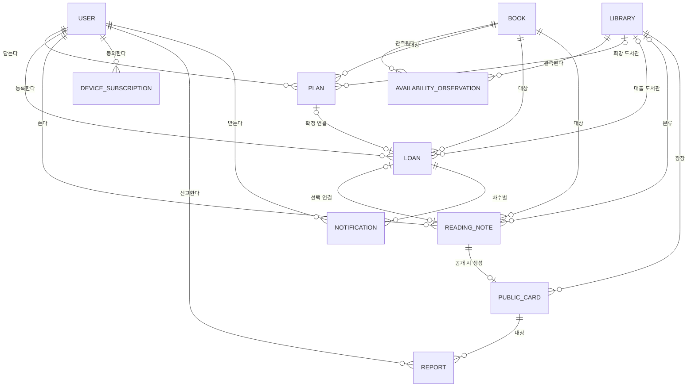

# 04. 도메인 모델 정의서

> 상태: **초안 — 사용자 검토 전**(2026-11-11). [02 요구사항 §3 논리 데이터](02_요구사항_정의서.md)와 §2 권한을 개념 수준으로 정리한 문서다. 테이블·컬럼·타입은 [05 ERD·DB 설계서](05_ERD_및_DB설계서.md)에서 정한다. 기능별 명세서에서 새 개념이 나오면 이 문서를 먼저 고친다.

## 1. 도메인 서술

동네 도서관의 **도서관**과 **도서**가 있고, 도서관마다 도서의 **소장·대출 가능 관측**이 시점과 출처와 함께 쌓인다. **사용자**는 도서를 **빌릴 예정**으로 담고, 도서관에서 빌린 뒤 직접 확인한 **개인 대출**을 등록한다. 대출의 반납 예정일이 다가오면 **알림**이 알림함에 생기고 동의한 경우 기기로 전송된다. 사용자는 **독서 기록**을 비공개로 쓰고, 원하면 공개용 내용만 뽑아 **공개 카드**로 도서관 광장에 올린다. 다른 사용자는 카드를 **신고**할 수 있고 **운영자**가 숨긴다.

## 2. 명사 추출 → 후보 분류

| 후보 | 판정 | 이유 |
| --- | --- | --- |
| 사용자(계정) | Entity | 개인 데이터 소유 주체. 인증 제공자(Supabase)의 식별자로 확정 |
| 공개 프로필 | 사용자의 속성 | 공개 표시명만. 이메일·인증 수단은 공개하지 않음 |
| 도서관 | Entity | 제공자 식별자·이름·위치. 공공 데이터 |
| 도서 | Entity | ISBN 유무로 구분(ISBN 없는 수동 기록 존재) |
| 소장·대출 관측 | Entity | 도서관×도서의 시점별 관측. 개인 데이터와 분리, 불변 기록 |
| 빌릴 예정 | Entity | 본인 전용 메모. 도서관 예약이 아님 |
| 개인 대출 | Entity | 사용자가 확인해 등록한 기록. 공식 내역과 구별 |
| 독서 기록 | Entity | 기본 비공개. 대출과 별개이며 연결은 선택 |
| 공개 카드 | Entity | 기록에서 뽑은 공개용 복사본. 원본 전체를 담지 않음 |
| 알림 | Entity | 대출·예정일 버전·차수별 한 건. 읽음과 전송 성공은 별개 |
| 기기 구독 | Entity | 푸시 수신 동의·토큰. 본인 전용 |
| 신고 | Entity | 신고자 비공개, 운영자만 처리 |
| 운영 처리 기록 | Entity | 숨김 사유·행위 감사 |
| 회원증 | 후보 Entity | 저장 정책 미확정 — 결정 전 수집·로그 금지(02 §3) |
| 연체 | 파생 상태 | 반납 예정일과 오늘(서울)로 계산. 저장하지 않음 |
| D-Day | 파생 값 | 위와 같음 |
| 반납 완료 | 대출의 상태값 | `대출중/반납완료` |
| 도서관 광장·내 발자취 | 화면 구성 | Entity 아님 |

## 3. Entity와 속성 (논리 수준)

필수/선택은 02 §3을 따른다. 타입·제약은 05에서 정한다.

| Entity | 필수 | 선택 | 소유·노출 |
| --- | --- | --- | --- |
| 사용자 | 불변 식별자, 계정 상태 | 공개 표시명 | 본인. 표시명만 공개 |
| 도서관 | 제공자 도서관 ID, 이름, 출처 | 주소, 좌표, 이용 안내, 갱신 시각 | 공공 |
| 도서 | 내부 ID, 제목, 출처 | ISBN, 저자, 출판사, 표지 URL | 공공 |
| 소장·대출 관측 | 도서관·도서, 소장 상태, 대출 가능 상태, 조회 시각, 출처 | 제공자 기준 시각 | 공공(개인 정보 없음) |
| 빌릴 예정 | 소유자, 도서, 도서관, 생성 시각, 상태(`예정/해제/대출확정 연결`) | 메모 | 본인 |
| 개인 대출 | 소유자, 도서, 대출일, 반납 예정일, 상태, 등록 출처 | 도서관, 연결된 예정, 실제 반납일 | 본인 |
| 독서 기록 | 소유자, 도서, 작성 시각, 공개 상태 | 감상, 독서일, 도서관, 대출 연결 | 본인(기본 비공개) |
| 공개 카드 | 작성자 공개 식별자, 도서, 게시 시각, 공개용 내용, 게시 상태(`공개/철회/운영숨김`), 도서관 | 공개 허용 이미지·인용문 | 공개 |
| 알림 | 소유자, 종류, 관련 대출, 예정일 버전, 차수, 수신 예정 시점, 읽음 상태 | 전송 결과 | 본인 |
| 기기 구독 | 소유자, 채널, 토큰 | 만료 시각 | 본인 |
| 신고 | 신고자, 공개 카드, 사유, 처리 상태 | 운영 처리 사유 | 신고자 비공개·운영자 |

## 4. 관계

| 관계 | 다중도·규칙 |
| --- | --- |
| 사용자 1 : N 빌릴 예정·대출·기록·알림 | 모두 소유자 한 명. 소유자 확인 없이 접근하는 경로를 만들지 않는다 |
| 도서관 N : M 도서 | 소장·대출 관측으로 연결(시점별 다건) |
| 빌릴 예정 0..1 : 0..1 대출 | 대출 확정 시 선택 연결 |
| 독서 기록 0..1 : 0..1 공개 카드 | 철회·숨김 후에도 기록 원본은 남는다 |
| 대출 1 : N 알림 | (대출, 예정일 버전, 차수)마다 한 건 |

## 5. 도메인 규칙

| # | 규칙 | 근거 |
| --- | --- | --- |
| R1 | 소장·대출 가능은 `있음·가능` / `없음·불가` / `알 수 없음` 세 갈래다. 응답을 못 받으면 `알 수 없음`이다 | 02 §3, AC-UNKNOWN |
| R2 | 공공 데이터의 상태 변화로 대출·반납을 자동 확정하지 않는다 | 02 §4-3, AC-HINT |
| R3 | 빌릴 예정은 같은 사용자·도서·도서관에서 활성 한 건이다. 예약이 아니다 | AC-PLAN |
| R4 | 개인 대출의 반납 예정일은 대출일보다 빠를 수 없다. 지난 대출·이미 연체된 대출은 입력할 수 있다 | AC-LOAN |
| R5 | 연체·D-Day는 서울 날짜로 계산하는 파생 값이다 | NFR-03 |
| R6 | 기본 반납 예정일 '대출일+14일'은 추정이며 확정 전 수정 가능하다 | AC-DATE |
| R7 | 알림은 (대출, 예정일 버전, 차수)당 한 건. 반납·기한 변경·삭제 시 이전 버전의 미전송 알림을 취소한다. 늦게 등록한 지난 차수는 몰아서 만들지 않는다 | AC-REMIND, AC-RETURN |
| R8 | 독서 기록은 기본 비공개다. 작성만으로 공개되지 않고, 공개 카드는 공개용 필드만 담는다 | AC-PUBLISH |
| R9 | 도서관 없는 기록을 임의의 도서관으로 보정하지 않는다 | AC-READ |
| R10 | 철회·운영 숨김한 카드는 목록·직접 주소 모두에서 읽을 수 없다 | AC-PUBLISH, AC-MOD |
| R11 | 도서관 회원증을 보여준 사실은 로그인·공식 인증·실제 대출의 증거가 아니다 | 02 §2 |
| R12 | 탈퇴 시 개인 대출·예정·기록·구독 삭제, 공개 카드 철회, 대기 알림 취소. 백업 잔존·보관 기간은 정책 승인 전 미확정 | AC-DELETE |
