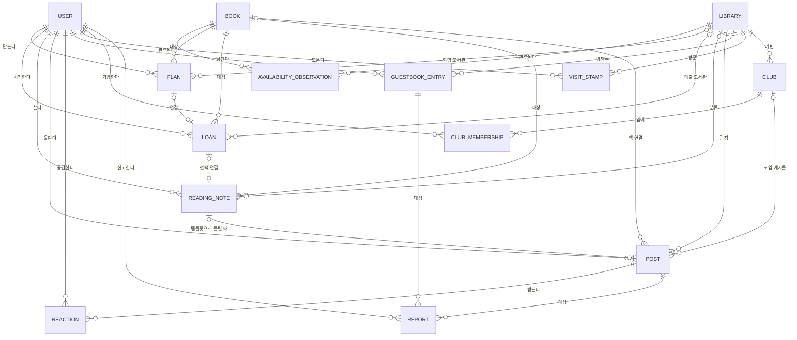

# 04. 도메인 모델 정의서

> 상태: **초안 — 사용자 검토 전**(2026-11-11, 같은 날 개정: 게시물·방문·모임 추가, 알림 단순화). [02 요구사항 §3 논리 데이터](02_요구사항_정의서.md)와 §2 권한을 개념 수준으로 정리한 문서다. 테이블·컬럼·타입은 [05 ERD·DB 설계서](05_ERD_및_DB설계서.md)에서 정한다. 기능별 명세서에서 새 개념이 나오면 이 문서를 먼저 고친다.

## 1. 도메인 서술

동네 **도서관**을 사용자가 "방문"하면 그 도서관의 **광장**에서 이웃이 올린 **게시물**을 보고, **방명록**에 글을 남기고, **오늘의 서가**를 둘러보며, **방문 스탬프**를 모은다. 게시물은 책 **도서**와 연결되고, 상세에서 도서관별 **소장·대출 가능 관측**을 조회하거나 외부 서점으로 이동한다. 사용자는 도서를 **빌릴 예정**으로 담고, 실제로 빌린 뒤 "빌렸어요"를 눌러 **개인 대출**을 시작한다. 대출의 반납 예정일에 맞춰 앱이 기기에 알림을 예약한다. 사용자는 **독서 기록**을 비공개로 쓰고, 원하면 템플릿으로 꾸며 **게시물**로 올린다. 같은 도서관의 이웃은 **모임**을 만들어 이번 달 책을 함께 읽는다. 다른 사용자는 게시물·방명록 글·모임 글을 **신고**할 수 있고 **운영자**가 숨긴다.

## 2. 명사 추출 → 후보 분류

| 후보 | 판정 | 이유 |
| --- | --- | --- |
| 사용자(계정) | Entity | 개인 데이터 소유 주체. 인증 제공자(Supabase)의 식별자로 확정 |
| 공개 프로필 | 사용자의 속성 | 공개 표시명만. 이메일·인증 수단은 공개하지 않음 |
| 도서관 | Entity | 제공자 식별자·이름·위치. 공공 데이터 |
| 도서 | Entity | ISBN 유무로 구분(ISBN 없는 수동 기록 존재) |
| 소장·대출 관측 | Entity | 도서관×도서의 시점별 관측. 개인 데이터와 분리, 불변 기록 |
| 빌릴 예정 | Entity | 본인 전용 메모. 도서관 예약이 아님 |
| 개인 대출 | Entity | 사용자가 "빌렸어요"로 시작한 기록. 공식 내역과 구별 |
| 독서 기록 | Entity | 기본 비공개. 대출과 별개이며 연결은 선택 |
| 게시물 | Entity | 광장에 올리는 공개 글(이미지 + 본문). 독서 기록과 독립적으로 쓸 수 있고, 템플릿으로 올릴 때만 기록과 연결 |
| 공감 | Entity | 게시물×사용자 하나. 인기 신호 |
| 방명록 글 | Entity | 도서관별 짧은 공개 글 |
| 방문 스탬프 | Entity | 사용자×도서관×날짜. 자기 선언 |
| 모임 | Entity | 도서관 기반 독서 모임 |
| 모임 가입 | Entity(관계) | 모임×사용자, 역할 |
| 신고 | Entity | 신고자 비공개, 운영자만 처리. 대상은 게시물·방명록 글·모임 글 |
| 운영 처리 기록 | Entity | 숨김 사유·행위 감사 |
| 기기 예약 알림 | Entity 아님 | 앱이 기기에 예약하는 것. 서버에 저장하지 않고 대출 데이터에서 다시 만든다 |
| 연체 | 파생 상태 | 반납 예정일과 오늘(서울)로 계산. 저장하지 않음 |
| D-Day | 파생 값 | 위와 같음 |
| 반납 완료 | 대출의 상태값 | `대출중/반납완료` |
| 오늘의 서가·추천 서적·인기글 | 파생 집계 | 공개 게시물(공감·언급)에서 계산. 저장 대상 아님(캐시 가능) |
| 광장·내 발자취·방문 화면 | 화면 구성 | Entity 아님 |

삭제한 개념(2026-11-11): 알림(서버 저장), 기기 구독, 회원증 — [C-11](스펙_변경_이력.md).

## 3. Entity와 속성 (논리 수준)

필수/선택은 02 §3을 따른다. 타입·제약은 05에서 정한다.

| Entity | 필수 | 선택 | 소유·노출 |
| --- | --- | --- | --- |
| 사용자 | 불변 식별자, 계정 상태 | 공개 표시명 | 본인. 표시명만 공개 |
| 도서관 | 제공자 도서관 ID, 이름, 출처 | 주소, 좌표, 이용 안내, 갱신 시각 | 공공 |
| 도서 | 내부 ID, 제목, 출처 | ISBN, 저자, 출판사, 표지 URL | 공공 |
| 소장·대출 관측 | 도서관·도서, 소장 상태, 대출 가능 상태, 조회 시각, 출처 | 제공자 기준 시각 | 공공(개인 정보 없음) |
| 빌릴 예정 | 소유자, 도서, 도서관, 생성 시각, 상태(`예정/해제/대출 연결`) | 메모 | 본인 |
| 개인 대출 | 소유자, 도서, 대출일(서버 서울 날짜), 반납 예정일, 상태 | 도서관, 연결된 예정, 실제 반납일 | 본인 |
| 독서 기록 | 소유자, 도서, 작성 시각, 공개 상태 | 감상, 독서일, 도서관, 대출 연결 | 본인(기본 비공개) |
| 게시물 | 작성자 공개 식별자, 도서관(광장), 이미지 종류(`사진/표지/단색`), 본문, 게시 시각, 게시 상태(`공개/철회/운영숨김`) | 도서, 이미지 위 글자, 템플릿, 연결된 독서 기록, 모임 | 공개 |
| 공감 | 게시물, 사용자 | — | 개수만 공개 |
| 방명록 글 | 도서관, 작성자 공개 식별자, 본문, 게시 시각, 상태 | — | 공개 |
| 방문 스탬프 | 소유자, 도서관, 날짜 | — | 본인 |
| 모임 | 도서관, 이름, 만든 사람 | 소개, 이번 달 책, 가입 방식 | 공개 |
| 모임 가입 | 모임, 사용자, 역할(`모임장/멤버`) | — | 본인·모임 |
| 신고 | 신고자, 대상, 사유, 처리 상태 | 운영 처리 사유 | 신고자 비공개·운영자 |

## 4. 관계

| 관계 | 다중도·규칙 |
| --- | --- |
| 사용자 1 : N 빌릴 예정·대출·기록·스탬프 | 모두 소유자 한 명. 소유자 확인 없이 접근하는 경로를 만들지 않는다 |
| 도서관 N : M 도서 | 소장·대출 관측으로 연결(시점별 다건) |
| 빌릴 예정 0..1 : 0..1 대출 | "빌렸어요" 시 선택 연결 |
| 독서 기록 0..1 : 0..1 게시물 | 철회·숨김 후에도 기록 원본은 남는다. 게시물은 기록 없이도 존재 |
| 게시물 1 : N 공감 | 사용자당 한 번 |
| 게시물 N : 1 도서관 | 모임 게시물도 도서관(광장 또는 모임의 도서관)에 속한다 |

## 5. 도메인 규칙

| # | 규칙 | 근거 |
| --- | --- | --- |
| R1 | 소장·대출 가능은 `있음·가능` / `없음·불가` / `알 수 없음` 세 갈래다. 응답을 못 받으면 `알 수 없음`이다 | 02 §3, AC-UNKNOWN |
| R2 | 공공 데이터의 상태 변화로 대출·반납을 추정하거나 자동 확정하지 않는다. 대출은 사용자가 "빌렸어요"를 눌러야 시작된다 | 02 §4-2, AC-LOAN |
| R3 | 빌릴 예정은 같은 사용자·도서·도서관에서 활성 한 건이다. 예약이 아니다 | AC-PLAN |
| R4 | 반납 예정일은 대출일보다 빠를 수 없다. 대출일은 서버의 서울 날짜로 기록한다 | AC-LOAN |
| R5 | 연체·D-Day는 서울 날짜로 계산하는 파생 값이다 | NFR-03 |
| R6 | 기본 반납 예정일 '오늘+14일'은 추정이며 수정 가능하다 | AC-DATE |
| R7 | 기기 예약 알림은 반납 예정일의 D-3·D-1·당일이다. 이미 지난 차수는 예약하지 않고, 반납·기한 수정 시 이전 예약을 지우고 다시 건다. 서버에 저장하지 않으며 앱이 열릴 때 대출 목록과 맞춘다. 도착은 보장하지 않는다 | AC-REMIND, AC-RETURN, AC-NOTIFY |
| R8 | 독서 기록은 기본 비공개다. 작성만으로 공개되지 않는다. 게시물은 올리기를 눌러야 공개되며, 기록에서 올릴 때 공개용 필드만 옮긴다 | AC-PUBLISH |
| R9 | 도서관 없는 기록을 임의의 도서관으로 보정하지 않는다 | AC-READ |
| R10 | 철회·운영 숨김한 게시물은 목록·직접 주소 모두에서 읽을 수 없다. 방명록 글·모임 글도 같다 | AC-PUBLISH, AC-MOD |
| R11 | 방문 스탬프·방명록·게시물은 대출·위치·실제 방문의 증거가 아니다. 인증 배지를 발급하지 않는다 | 02 §2 |
| R12 | 탈퇴 시 개인 대출·예정·기록·스탬프 삭제, 공개 게시물·방명록 글 철회, 기기 예약 알림 해제. 백업 잔존·보관 기간은 정책 승인 전 미확정 | AC-DELETE |
| R13 | 로그아웃 시 이전 사용자의 기기 예약 알림을 모두 해제한다 | AC-AUTH |
| R14 | 공감은 게시물당 사용자 하나이며 취소할 수 있다. 개수만 공개한다 | AC-FEED |
| R15 | 인기글·추천 서적·오늘의 서가는 공개 게시물만으로 계산한다. 비공개 기록·대출은 집계에 쓰지 않는다 | AC-VISIT |
