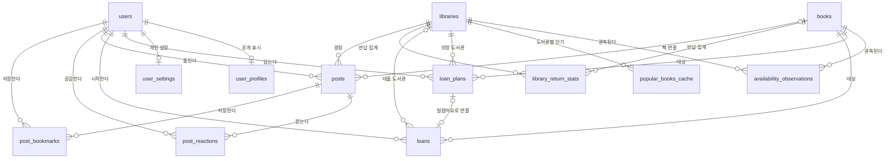

# 05. ERD 및 DB 설계서

> 상태: **M1 테이블 골격 — 선행 설계 원본(2026-11-13, D 승인 방향 [C-53](스펙_변경_이력.md), 기준선 B0)**. 담당: D.
> **이 문서가 M1 테이블의 존재·목적·관계·소유자 컬럼·핵심 제약·RLS 방침의 원본이다.** 기능별 계약서(`../team/contracts/<기능>.md` §3.4)는 여기서 정한 골격을 컬럼·타입·기본값·삭제 동작까지 구체화한다. 계약서가 이 문서와 달라져야 하면 **이 문서를 먼저 고치고**([스펙 변경 이력](스펙_변경_이력.md) 한 행) 계약서를 맞춘다. 지금 스키마의 사실은 마이그레이션 파일이다(아직 없음, 첫 마이그레이션은 AUTH-1 파트 1).
> 입력: [04 도메인 모델](04_도메인_모델_정의서.md), [02 요구사항 §3·§4](02_요구사항_정의서.md), [모호점 해소 기록](모호점_해소_기록.md) "2026-11-13 계약 전 확인 답변", `../team/contracts/auth.md` AUTH-1(초안).

## 0. 읽는 법

| 상태 | 뜻 | 계약서에서 |
| --- | --- | --- |
| `확정` | 사용자·D 결정이나 02·04의 M1 행에 근거가 있다 | 그대로 쓴다 |
| `기본값(Claude)` | 결정이 없어 문서화된 결정·표준에서 추론해 정했다. D가 PR에서 본다 | 그대로 쓰되, 바꾸려면 이 문서를 먼저 고친다 |
| `미확인(임시)` | 외부 조건이나 미결 질문에 걸려 있다. Q-번호가 붙는다 | 임시 값으로 진행하고 Q가 풀리면 고친다. 확정처럼 쓰지 않는다 |

- **주니어(A·B·C) 영역 테이블은 존재·목적·소유자 컬럼·핵심 제약까지만 적는다.** 컬럼 세부·길이·개수는 세부 명세서가 정하고 계약서가 옮긴다. D 영역 테이블은 컬럼 수준까지 적는다.
- 공통 규칙(전부 `기본값(Claude)`, 근거: AUTH-1 계약서 §3.4):
  - 개인 데이터의 소유자 컬럼은 `user_id uuid NOT NULL REFERENCES users(id)`. `ON DELETE`는 AUTH-3 계약서가 정하기 전까지 `NO ACTION`.
  - 개인·공개 행의 기본 키는 `uuid`(`gen_random_uuid()`), 공공 참조 데이터(도서관·도서)는 `bigint GENERATED ALWAYS AS IDENTITY`. 이유: 개인·공개 행의 id는 주소에 드러나므로 순번으로 남의 것을 짐작하지 못하게 한다.
  - 시각은 `timestamptz`, 서울 날짜는 `date`(서버가 KST로 계산해 넣는다, NFR-03). 상태값은 `text` + `CHECK`(영문 소문자).
  - 모든 테이블에 `ENABLE ROW LEVEL SECURITY`, 정책 없음(§4).
- DB는 PostgreSQL(Supabase). **메이저 17은 가정**이다(시험 컨테이너 `postgres:17`, Supabase 프로젝트 생성 때 확인 — [기준선 §3](기준선.md)).

## 1. ERD (M1)

`provider_daily_usage`는 다른 테이블과 관계가 없어 그림에 없다. `library_return_stats`에는 `users`와의 선이 **없다**(user id와 연결하지 않음, 02 §3).

## 2. 테이블 목록 (M1 — 제품 테이블 14개 + Alembic 버전 표)

| # | 테이블 | 목적 | 담당(Step) | 소유자 컬럼 | 요구사항 | 상태 |
| --- | --- | --- | --- | --- | --- | --- |
| 1 | `users` | 이 서비스의 사용자 한 명(Supabase 사용자와 1:1) | D (AUTH-1) | `id`(자기 자신) | AUTH-01~03, USR-01·02 | `확정`(Q-52) · 컬럼은 AUTH-1 계약서 초안과 같음 |
| 2 | `user_profiles` | 남에게 보이는 표시 이름(게시물 작성자 표시) | D (AUTH-1 뒤, LOCAL-1 전) | `user_id` | LOCAL-03("작성자만 작게"), 02 §3 계정/프로필 | `미확인(임시)` Q-55: 프로필은 요구사항 ID가 없다. M1에는 닉네임 하나만 |
| 3 | `user_settings` | 본인만 보는 설정: 내 주변 반경, 반납 집계 동의 | D | `user_id` | LIB-02(3km/5km), LOAN-03(동의) | 반경 `확정`(O-39) · 동의 칸 `미확인(임시)` Q-49 |
| 4 | `libraries` | 공공 도서관 정보(매일 갱신) | D (조회 엔진, LIB-2) | 없음(공공) | LIB-02, VISIT-01·02 | `확정`(2026-11-13 답변) |
| 5 | `books` | 도서 서지(검색·상세에서 본 책을 저장) | D (조회 엔진, LIB-1) | 없음(공공) | LIB-01, LOCAL-02 | `확정` · 표지 조건 `미확인(임시)` Q-41 |
| 6 | `availability_observations` | (도서관, 책)의 소장·대출 가능 관측. 캐시 겸용 | D (조회 엔진, LIB-2) | 없음(공공) | LIB-03·04·07, AC-UNKNOWN | `확정`(DB 캐시, Q-14) |
| 7 | `popular_books_cache` | 전국·도서관별 인기 도서 목록 캐시 | D (조회 엔진, LIB-1) | 없음(공공) | LIB-01(검색 진입 추천) | 캐시 주기 `확정` · 어느 API인지 `미확인(임시)` Q-42 |
| 8 | `provider_daily_usage` | 외부 제공자 하루 호출 수(상한 지키기) | D (조회 엔진) | 없음 | NFR-02 | 상한 값 `확정`(Q-18 일부) |
| 9 | `loan_plans` | 빌릴 예정(본인 메모, 도서관 예약 아님) | C (LIB-3) | `user_id` | LIB-05, AC-PLAN | `확정` |
| 10 | `loans` | "빌렸어요"로 시작한 개인 대출 | C (LOAN-1·2) | `user_id` | LOAN-01~03, AC-LOAN·AC-DATE | `확정` · 중복 기준 `미확인(임시)` Q-21 |
| 11 | `library_return_stats` | 동의한 이용자의 반납을 도서관-책-날짜로만 쌓은 집계 | C (LOAN-2에서 쓰기) / 보여 주기는 M2 | **없음(일부러)** | LOAN-03, VISIT-04(M2) | `미확인(임시)` Q-49 |
| 12 | `posts` | 광장 게시물 | B (LOCAL-1) | `user_id`(작성자) | LOCAL-01·02, AC-PUBLISH | `확정` · 사진 저장소 `미확인(임시)` Q-53 |
| 13 | `post_reactions` | 공감(하트) | B (LOCAL-2) | `user_id` | LOCAL-06, AC-FEED | `확정` |
| 14 | `post_bookmarks` | 게시물 북마크(저장·해제만) | B (LOCAL-2) — 담당은 `미확인` | `user_id` | LOCAL-03(카드 메뉴의 북마크) | `미확인(임시)` Q-56: 북마크 모음은 요구사항 ID가 없다 |
| 15 | (마이그레이션 관리) `alembic_version` | Alembic이 만드는 버전 표 | D (AUTH-1 파트 1) | 없음 | — | `확정`(Q-28) |

A(`library-visit`)는 M1에 자기 테이블이 없다. 지도·방문 페이지는 `libraries`와 B의 피드를 읽기만 하고, 도서관 기본값은 기기에 둔다(§6).

## 3. 테이블별 골격

### 3.1 D 영역 (컬럼 수준)

**`users`** — AUTH-1 계약서 §3.4와 같다. 다른 컬럼을 더하지 않는다(이메일·제공자 정보는 Supabase `auth` 스키마에만).

| 컬럼 | 타입 | 제약 | 설명 | 상태 |
| --- | --- | --- | --- | --- |
| `id` | `uuid` | PK | Supabase 사용자 id(토큰의 `sub`) | `확정` |
| `status` | `text` | NOT NULL, 기본 `'active'`, CHECK `IN ('active','withdrawn')` | 계정 상태. `withdrawn`은 AUTH-3 | `확정` |
| `created_at` | `timestamptz` | NOT NULL, 기본 `now()` | 처음 `POST /auth/session` 시각 | `확정` |

**`user_profiles`** — 행은 `POST /auth/session`이 `users`와 같은 트랜잭션에서 만든다(`기본값(Claude)`: 그래야 게시물 작성자 표시가 비지 않는다. AUTH-1 계약서에 반영 필요 — §9).

| 컬럼 | 타입 | 제약 | 설명 | 상태 |
| --- | --- | --- | --- | --- |
| `user_id` | `uuid` | PK, FK → `users.id` | 소유자 | `기본값(Claude)` |
| `nickname` | `text` | NOT NULL, 길이 CHECK | 공개 표시 이름. 처음에는 자동으로 만든 이름(예: `이웃-3f2a`) | `미확인(임시)` Q-55: 자동 이름 규칙·중복 허용·바꾸는 화면 |
| `updated_at` | `timestamptz` | NOT NULL, 기본 `now()` | | `기본값(Claude)` |

프로필 사진·한 줄 소개·팔로우는 요구사항 ID가 없어(02 §0 "ID 미부여") M1 골격에 넣지 않는다.

**`user_settings`** — 행이 없으면 기본값으로 읽는다(행은 처음 바꿀 때 만든다).

| 컬럼 | 타입 | 제약 | 설명 | 상태 |
| --- | --- | --- | --- | --- |
| `user_id` | `uuid` | PK, FK → `users.id` | 소유자 | `기본값(Claude)` |
| `nearby_radius_km` | `smallint` | NOT NULL, 기본 `3`, CHECK `IN (3, 5)` | 내 주변 반경 | `확정`(O-39) |
| `return_stats_consent_at` | `timestamptz` | NULL 허용 | 반납 집계 동의 시각. NULL이면 동의 안 함 | `미확인(임시)` Q-49(동의 방식·철회) |
| `updated_at` | `timestamptz` | NOT NULL, 기본 `now()` | | `기본값(Claude)` |

**`libraries`** — 정보나루 `libSrch`를 매일 받아 해시가 달라진 곳만 고친다.

| 컬럼 | 타입 | 제약 | 설명 | 상태 |
| --- | --- | --- | --- | --- |
| `id` | `bigint` | PK | 내부 id | `기본값(Claude)` |
| `provider_lib_code` | `text` | NOT NULL, UNIQUE | 정보나루 `libCode` | `확정` |
| `name` | `text` | NOT NULL | | `확정` |
| `address`, `tel`, `homepage` | `text` | NULL 허용 | | `확정` |
| `latitude`, `longitude` | `double precision` | NULL 허용(둘 다 있거나 둘 다 없음 CHECK) | 없으면 "거리 계산 불가" | `확정`(02 §3) |
| `closed_text`, `operating_time_text` | `text` | NULL 허용 | 제공자 원문 그대로(자유 문장) | `확정`(Q-22) |
| `region_code`, `dtl_region_code` | `text` | NULL 허용 | 시·도, 시군구 코드 | `확정`(Q-51 ①) |
| `isbn_search_url_template` | `text` | NULL 허용 | "실시간 확인" 주소 규칙. 없으면 `homepage`로 | `미확인(임시)` Q-48(대상 도서관·주소 규칙 미정) |
| `content_hash` | `text` | NOT NULL | 갱신 비교용 | `확정` |
| `synced_at` | `timestamptz` | NOT NULL | 마지막으로 받은 시각 | `확정` |

도서관 룩(VISIT-07)은 M2라 컬럼을 두지 않는다. 휴관일 계산 결과는 저장하지 않고 `closed_text`에서 매번 계산한다(`기본값(Claude)`).

**`books`**

| 컬럼 | 타입 | 제약 | 설명 | 상태 |
| --- | --- | --- | --- | --- |
| `id` | `bigint` | PK | 내부 id | `기본값(Claude)` |
| `isbn13` | `text` | NULL 허용, UNIQUE, 13자리 숫자 CHECK | 10자리는 서버가 13자리로 바꿔 넣는다. ISBN 없는 수동 기록(M2)은 NULL | `확정` |
| `title` | `text` | NOT NULL | | `확정` |
| `author`, `publisher` | `text` | NULL 허용 | | `확정` |
| `cover_url` | `text` | NULL 허용 | **주소만 저장하고 이미지는 복사하지 않는다.** `http://`는 `https://`로 바꿔 넣는다 | `확정`(2026-11-13) · 이용 조건 `미확인(임시)` Q-41 |
| `source` | `text` | NOT NULL, CHECK `IN ('naver','data4library','manual')` | 서지 출처 | `기본값(Claude)` |
| `fetched_at` | `timestamptz` | NOT NULL | | `기본값(Claude)` |

**`availability_observations`** — 같은 (도서관, 책)은 서울 날짜 하루에 한 행이고, 그날 자정(KST)까지 다시 부르지 않는다.

| 컬럼 | 타입 | 제약 | 설명 | 상태 |
| --- | --- | --- | --- | --- |
| `library_id` | `bigint` | FK → `libraries.id` | | `확정` |
| `book_id` | `bigint` | FK → `books.id` | | `확정` |
| `observed_on` | `date` | PK (`library_id`, `book_id`, `observed_on`) | 조회한 서울 날짜 | `확정`(당일 자정까지 보관) |
| `holding` | `text` | NOT NULL, CHECK `IN ('yes','no','unknown')` | 소장 | `확정`(R1) |
| `loanable` | `text` | NOT NULL, CHECK `IN ('yes','no','unknown')` | 대출 가능 | `확정`(R1) |
| `data_date` | `date` | NULL 허용 | 제공자 데이터 기준일. 응답에 없으면 `observed_on` 전날로 채우고 `data_date_assumed = true` | `확정`(LIB-03) · 필드 유무 `미확인(임시)` Q-18 |
| `data_date_assumed` | `boolean` | NOT NULL, 기본 `false` | 기준일을 추정했는지(숨기지 않음) | `확정`(LIB-03) |
| `observed_at` | `timestamptz` | NOT NULL | 조회 시각 | `확정` |
| `source` | `text` | NOT NULL | 출처(`data4library`) | `확정` |

`unknown`(시간 초과 5초·오류)은 캐시로 치지 않고 다음 요청에서 다시 부른다(`기본값(Claude)`). 지난 날짜의 행을 지울지 남길지는 LIB-2 계약서에서 정한다.

**`popular_books_cache`**

| 컬럼 | 타입 | 제약 | 설명 | 상태 |
| --- | --- | --- | --- | --- |
| `scope` | `text` | CHECK `IN ('national','library')` | | `확정` |
| `library_id` | `bigint` | FK, `scope='library'`일 때만 NOT NULL(CHECK) | | `확정` |
| `rank` | `smallint` | PK (`scope`, `library_id`, `rank`) — NULL은 부분 UNIQUE 인덱스 두 개로 처리 | 순위 | `기본값(Claude)` |
| `book_id` | `bigint` | FK → `books.id` | | `기본값(Claude)` |
| `period_label` | `text` | NOT NULL | 화면에 보여 줄 기준(예: "전국 · 최근 30일") | `확정`(기준 표시, LIB-01) |
| `fetched_at` | `timestamptz` | NOT NULL | 전국은 하루 한 번, 도서관별은 누가 열 때 받아 3일 보관 | `확정`(2026-11-13) |

어느 조회(`loanItemSrchByLib` 기간 지정 / 통합 최근 30일 상위 20권)를 쓸지는 `미확인(임시)` Q-42 — LIB-2 계약서에서 정한다.

**`provider_daily_usage`**

| 컬럼 | 타입 | 제약 | 설명 | 상태 |
| --- | --- | --- | --- | --- |
| `provider` | `text` | CHECK `IN ('data4library','naver','yes24','kakao')` | | `기본값(Claude)` |
| `usage_date` | `date` | PK (`provider`, `usage_date`) | 서울 날짜 | `기본값(Claude)` |
| `call_count` | `integer` | NOT NULL, 기본 `0`, CHECK `>= 0` | 원자적 증가(`UPDATE … SET call_count = call_count + 1`) | `기본값(Claude)` |

상한: 정보나루 일 21,000건(30,000의 70%) `확정`, 네이버 일 25,000건은 제공자 한도이며 앱 상한은 `미확인(임시)` Q-41, 예스24·카카오는 `미확인(임시)` Q-41·Q-12. Redis 대신 DB에 둔다(Q-14).

### 3.2 주니어 영역 (존재·목적·소유자 컬럼·핵심 제약까지)

컬럼 세부·길이·개수·화면 동작은 세부 명세서가 정하고 계약서 §3.4가 옮긴다. 아래 "핵심 제약"은 계약서가 빼거나 바꾸지 못한다.

| 테이블 | 담당 | 소유자 컬럼 | 꼭 있어야 하는 것 | 핵심 제약 | 근거 | 상태 |
| --- | --- | --- | --- | --- | --- | --- |
| `loan_plans` | C (LIB-3) | `user_id` | 책(`book_id`), 도서관(`library_id`, NOT NULL), 상태(`planned`/`released`/`converted`), 만든 시각 | **부분 UNIQUE** (`user_id`, `book_id`, `library_id`) `WHERE status = 'planned'` — 활성 예정은 하나 | R3, AC-PLAN | `확정` |
| `loans` | C (LOAN-1·2) | `user_id` | 책(`book_id`), 대출일 `loaned_on date`(서버 KST), 반납 예정일 `due_on date`, 상태(`on_loan`/`returned`), 실제 반납일(NULL 허용), 도서관(NULL 허용), 연결된 예정(NULL 허용) | **CHECK** `due_on >= loaned_on` · **CHECK** `(status = 'returned') = (returned_on IS NOT NULL)` · **UNIQUE** `plan_id`(예정 하나는 대출 하나에만) · 연타 방지 **부분 UNIQUE** (`user_id`, `book_id`) `WHERE status = 'on_loan'` | R4, AC-LOAN, AC-RETURN | `확정` · 마지막 부분 UNIQUE(같은 책을 두 권 동시에 못 빌림)는 `미확인(임시)` Q-21 |
| `library_return_stats` | C (LOAN-2가 쓴다) | **없음** | 도서관, 책, 반납일(서울 날짜), 건수 | **PK** (`library_id`, `book_id`, `returned_on`) · `user_id`·`loan_id` 컬럼을 **두지 않는다** · 도서관 없는 대출은 쌓지 않는다 · 동의(`user_settings.return_stats_consent_at`)가 있을 때만 +1 | 02 §3·§4-9, R15 | `미확인(임시)` Q-49. **쓰기는 LOAN-2 계약서에서 켠다. 그 전에는 테이블만 있고 아무도 쓰지 않는다** |
| `posts` | B (LOCAL-1) | `user_id`(작성자) | 도서관(`library_id`, NOT NULL — 광장), 책(`book_id`, NULL 허용), 이미지 종류(`photo`/`cover`/`color`), 이미지 값(사진 경로·표지 주소·색 중 종류에 맞는 하나), 이미지 위 글자(NULL 허용), 본문(NULL 허용 — 이미지만 게시 가능), 상태(`published`/`withdrawn`/`hidden`), 게시 시각 | **CHECK** 상태 세 값 · **CHECK** 이미지 종류와 이미지 값이 맞음 · 초안은 서버에 저장하지 않는다(올리기를 눌러야 행이 생김) · 응답에 작성자의 `user_id` 대신 `user_profiles.nickname`만 | LOCAL-01, R8·R10, AC-PUBLISH | `확정` · 사진 저장소·용량 `미확인(임시)` Q-53 · `hidden`은 M2(LOCAL-4)가 쓰고 M1에는 쓰는 코드 없음 |
| `post_reactions` | B (LOCAL-2) | `user_id` | 게시물(`post_id`), 누른 시각 | **PK** (`post_id`, `user_id`) — 사용자당 하나 | R14, AC-FEED | `확정` |
| `post_bookmarks` | B (LOCAL-2, 담당 `미확인`) | `user_id` | 게시물(`post_id`), 저장 시각(다시 저장하면 새 시각) | **PK** (`user_id`, `post_id`) · 본인만 조회 | LOCAL-03, R16 | `미확인(임시)` Q-56 |

- `posts`에 좋아요 수 컬럼을 둘지(비정규화)는 LOCAL-2 계약서에서 정한다. 인기순 기준은 `미확인(임시)` Q-31이라 **M1 골격에는 인기순용 컬럼·인덱스를 넣지 않는다**(최신순만 확정).
- 방명록·모임·방문 기록 카드는 M2라 `post_bookmarks`는 게시물만 가리킨다. M2에서 카드 종류가 늘 때 대상 표현을 다시 정한다.

## 4. 소유권·접근 제어

| 항목 | 방침 | 상태 |
| --- | --- | --- |
| 사용자 확정 | 요청 본문·쿼리의 id를 믿지 않고 토큰의 `sub`만 쓴다(`get_current_user`) | `확정`(02 §3, AUTH-1 A3) |
| 소유자 조건 | 개인 테이블의 모든 조회·수정·삭제 SQL에 `user_id = :current_user`를 넣는다. 타인 것과 없는 것은 **같은 응답**(404 `NOT_FOUND`)으로 거부한다 | `확정`(USR-02, AC-ISOLATION) |
| **RLS** | **모든 테이블에 `ALTER TABLE … ENABLE ROW LEVEL SECURITY`, 정책 없음.** Supabase는 `public` 스키마를 publishable 키로 REST에 열어 두므로, 정책이 없어야 앱이 서버를 거치지 않고 표를 읽지 못한다. 서버는 테이블 소유자 계정으로 붙어 RLS의 영향을 받지 않는다. RLS가 자동으로 켜진다고 가정하지 않고 마이그레이션마다 줄을 넣는다(AUTH-1 계약서 §3.4의 RLS 줄을 그대로 옮김) | `기본값(Claude)` → D가 AUTH-1 계약서를 승인하면 `확정` |
| RLS 시험 | 테이블마다 `relrowsecurity = true`이고 `pg_policies`에 정책 0개인지 확인하는 시험 한 줄(AUTH-1의 `test_users_rls_enabled`와 같은 모양) | `기본값(Claude)` |
| 접근 경로 | 앱 → FastAPI → DB만. 앱에 `service_role`·secret 키를 넣지 않는다 | `확정`(NFR-04) |
| `auth` 스키마 | `auth.users`에 FK를 걸지 않는다(시험 DB에 `auth` 스키마가 없다) | `기본값(Claude)`(AUTH-1 §3.4) |
| 공개 데이터 | `libraries`·`books`·`availability_observations`·`popular_books_cache`·공개 상태의 `posts`는 로그인 없이 읽는다(02 §2 방문자). 파일럿 동안 게시물을 참여자에게만 보이는 방법은 `미확인(임시)` Q-54 | `확정` / Q-54 |

## 5. 04 규칙 → 제약 → 시험

| 04 규칙 | 테이블 제약 | 시험이 잡을 것 | 상태 |
| --- | --- | --- | --- |
| R1 세 갈래 | `availability_observations.holding`·`loanable` CHECK 세 값 | 오류를 `no`로 저장하면 실패 | `확정` |
| R3 활성 예정 하나 | `loan_plans` 부분 UNIQUE | 같은 책·도서관을 두 번 담으면 한 건 | `확정` |
| R4 날짜 역전 금지 | `loans` CHECK `due_on >= loaned_on` | 대출일 전날로 고치면 거부, 행 그대로 | `확정` |
| R4 대출일은 서버 서울 날짜 | DB 제약 없음. 서버가 `today_kst()`로 넣고 본문 값은 받지 않는다 | 본문에 `loaned_on`을 보내도 무시 | `확정` |
| R5 연체·D-day | **저장하지 않는다**(§6) | — | `확정` |
| R10 철회 뒤 차단 | `posts.status` CHECK. 읽기 SQL은 `status = 'published'`만 | 철회 뒤 목록·직접 주소 모두 안 보임 | `확정` |
| R14 공감 하나 | `post_reactions` PK | 두 번 눌러도 한 행 | `확정` |
| R15 집계에 user id 없음 | `library_return_stats`에 `user_id` 컬럼 없음 | 컬럼 목록에 `user_id`·`loan_id`가 없음 | `미확인(임시)` Q-49 |
| R16 모음은 본인만 | `post_bookmarks` 읽기는 `user_id = :current_user`만 | 남의 id로 조회하면 내 것만 나옴 | `미확인(임시)` Q-56 |
| R12 탈퇴 | `ON DELETE` 동작과 지울 순서 | AUTH-3 계약서에서 | `미확인(임시)`(AUTH-3, Q-23) |

## 6. 서버에 저장하지 않는 것·파생 값

| 무엇 | 어디에 두나 | 근거 | 상태 |
| --- | --- | --- | --- |
| 기기 예약 알림 | 기기. 대출 목록에서 다시 만든다 | R7, C-11 | `확정` |
| 연체·D-day | 응답 때 `due_on`과 서울 오늘로 계산 | R5 | `확정` |
| 정확한 위치·집 주소·보는 위치 | 저장하지 않는다. 좌표는 요청마다 받아 거리 계산에만 쓰고 로그에도 남기지 않는다 | NFR-05, `library-visit` 결정 1·13 | `확정` |
| 최근 본 도서 | **기기**(최대 10개). 서버 테이블 없음 | 2026-11-13 D 답변(LIB-1) | `미확인(임시)`: 02 LIB-01·04는 "계정별 최근 20권"이라 값이 다르다(02 반영 대기). 02를 고칠 때까지 서버 테이블을 만들지 않는다 |
| 도서관 기본값 | **기기**(도서관 id 하나) | `library-visit` 결정 14, 2차 리뷰 "저장 범위는 계약 때" | `기본값(Claude)`: 로그인 없이도 써야 하고 기기마다 사는 곳이 같으므로 |
| 도서관 방문 횟수 | **기기**(도서관별 방문 횟수·마지막 방문 날짜·연속 일수·기본값을 물었는지). 방문 멘트 카드와 "세 번째 방문 때 물어봄"에 쓴다. M2 방문 스탬프(§10)와는 별개 값 | [D 결정 1.2-1](명세/VISIT_LOCAL_D결정.md)(2026-11-13 D: "방문 횟수에 대한 값을 저장"), C-55 | 저장한다는 것은 `확정`, 기기에 둔다는 것과 세는 단위(도서관마다 하루 한 번)는 `기본값(Claude)`: 도서관 기본값과 같은 자리이고 로그인 없이도 써야 하므로 |
| 게시물 초안 | 기기(올리기 전에는 서버에 없음) | LOCAL-01 "올리기를 눌러야 공개" | `기본값(Claude)` |
| 세션·리프레시 토큰 | Supabase | AUTH-1 A4 | `확정` |
| 서가 테마 | M1에는 표가 없다. 검색 추천은 "활성 테마 없음 → 인기 도서"로만 동작한다 | LIB-01, Q-47(운영 화면은 M2) | `기본값(Claude)` |

## 7. 인덱스 (조회 패턴만 — 값은 계약서에서)

| 조회 | 필요한 인덱스 | 담당 계약서 |
| --- | --- | --- |
| 도서관 광장 최신순 | `posts (library_id, published_at DESC) WHERE status = 'published'` | LOCAL-2 |
| 같은 책 이어 읽기 | `posts (book_id, published_at DESC) WHERE status = 'published'` | LOCAL-2 |
| 내 대출·내 예정 | `loans (user_id, status)`, `loan_plans (user_id, status)` | LOAN-1, LIB-3 |
| 주변 도서관 | `libraries (dtl_region_code)`. 반경 계산은 약 1,300곳이라 서버에서 직선거리로 계산한다(공간 인덱스·PostGIS 없음) | LIB-2 |

실행 계획(EXPLAIN) 비교는 테이블이 생긴 뒤 계약서·결과 문서에 적는다(지금은 테이블이 없다).

## 8. 마이그레이션

- 도구는 Alembic(Q-28). 규칙은 AUTH-1 계약서 §3.4 아래 줄과 같다: 파일 이름 `NNNN_<무엇>.py`, `downgrade()` 필수, CI 서버 job이 `pytest` 앞에 `alembic upgrade head`.
- 순번은 **머지 순서**로 매긴다. 두 파트가 같은 번호를 잡으면 나중에 머지되는 쪽이 번호를 올린다(`기본값(Claude)`).
- 예상 순서(선행 관계만, 번호 아님): `users` → `user_profiles`·`user_settings` → `libraries`·`books` → `availability_observations`·`popular_books_cache`·`provider_daily_usage` → `loan_plans` → `loans`·`library_return_stats` / `posts` → `post_reactions`·`post_bookmarks`.
- 탈퇴·삭제 처리와 보관 기간은 AUTH-3 계약서에서 정한다(Q-23, 출시 관문).

## 9. 계약서와 맞출 것

| 계약서 | 이 문서와 다른 곳 | 할 일 |
| --- | --- | --- |
| `auth.md` AUTH-1(초안) | `users`는 같다. `user_profiles` 행을 `POST /auth/session`이 함께 만든다는 줄이 계약서에 없다(파트 1 금지 결정에 "닉네임 컬럼"이 있음) | D가 정한다: ① AUTH-1에 넣는다 ② LOCAL-1 전의 별도 파트로 둔다(추천 — AUTH-1 초안을 건드리지 않음) |
| 이후 계약서 전부 | §3.4 표를 쓸 때 이 문서의 해당 행을 먼저 옮기고, 핵심 제약을 빼지 않는다 | `../team/templates/계약.md` 머리 문구(C-53) |

## 10. M1에 없는 것 (이름만)

독서 기록, 방명록 글, 방문 스탬프, 모임·모임 참가·댓글·후기·참가 제한, 신고·운영 처리 기록, 팔로우, 알림함 항목, 서가 테마, 도서관 룩 — 04에 개념이 있고 M2 이후에 테이블을 정한다. 이 문서에 미리 넣지 않는다.

## 11. 미확인 모음 (이 문서에서 임시로 둔 것)

| Q | 무엇 | 임시로 둔 값 | 풀리면 고칠 곳 |
| --- | --- | --- | --- |
| Q-18 | 정보나루 기준일 필드 유무·`pageSize` 최대 | 기준일 없으면 전날로 추정하고 표시 | `availability_observations` |
| Q-21 | 같은 책 중복 대출 기준 | 대출 중인 같은 책은 한 건 | `loans` 부분 UNIQUE |
| Q-31 | 인기순 집계 기준 | 인기순용 컬럼·인덱스 없음 | `posts` |
| Q-41 | 표지·구매 API 조건, 네이버 앱 상한 | 표지는 주소만 저장 | `books.cover_url`, `provider_daily_usage` |
| Q-42 | 인기 도서 API 선택 | 캐시 표 모양만 | `popular_books_cache` |
| Q-48 | 실시간 확인 주소 규칙 | 컬럼만 두고 비워 둠 | `libraries.isbn_search_url_template` |
| Q-49 | 반납 집계 동의·재식별 방지 | 표와 동의 칸만, 쓰기 꺼 둠 | `library_return_stats`, `user_settings` |
| Q-53 | 게시물 사진 저장소·용량·형식 | Supabase Storage에 올리고 DB에는 경로만(가정) | `posts` |
| Q-54 | 파일럿 동안 게시물을 참여자에게만 보이는 방법 | 정하지 않음(공개 읽기 그대로) | §4, 06 인증 칸 |
| Q-55 | M1 작성자 표시 이름(프로필 ID 없음) | 자동으로 만든 닉네임 하나 | `user_profiles` |
| Q-56 | 북마크의 요구사항 ID·담당 | 게시물 저장·해제만 | `post_bookmarks` |
| — | Supabase Postgres 메이저 | 17 가정 | 전체 |

## 12. 아직 쓰지 않은 것

검증 결과(제약 위반 거부 실행 로그), EXPLAIN 비교, 정규화·비정규화 근거 절은 테이블이 실제로 생긴 뒤에 채운다.
