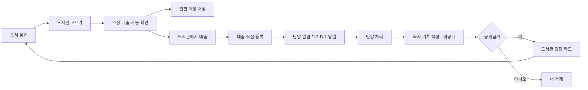
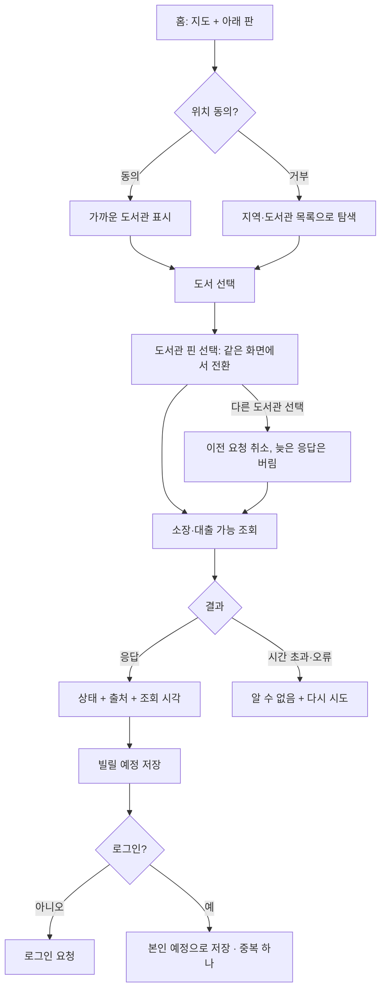
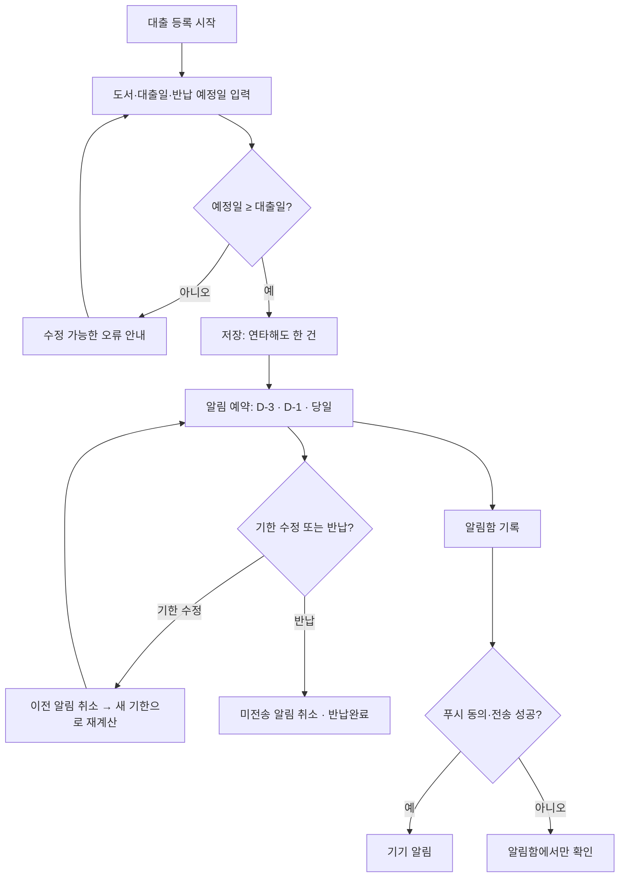
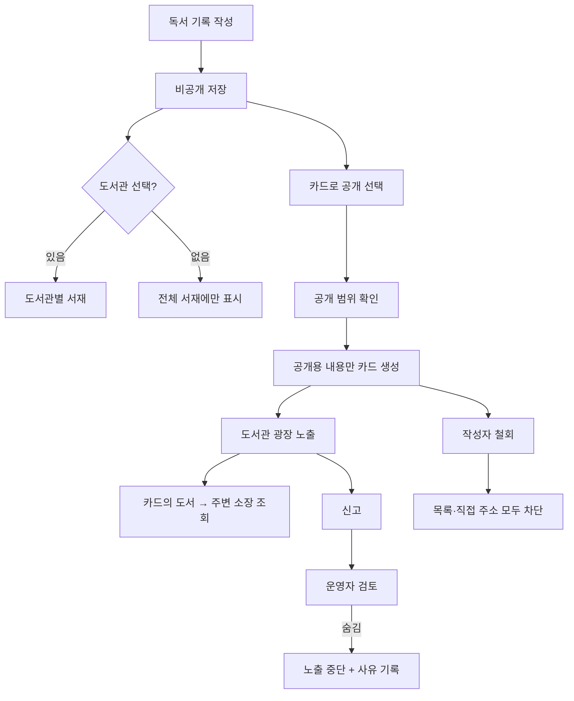
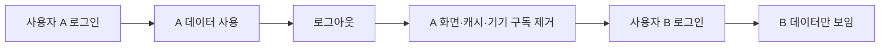

# 유저 플로우

> 상태: **초안 — 사용자 검토 전**(2026-11-11). [02 요구사항](02_요구사항_정의서.md)의 핵심 경험을 흐름으로 그린 문서다. 화면 단위의 상세 흐름은 기능별 명세서의 `정상 흐름`·`예외 상황`이 원본이고, 이 문서는 기능을 가로지르는 여정과 분기만 다룬다. 화면 구성은 [와이어프레임](와이어프레임.md).

## 1. 전체 순환 여정

## 2. 도서 탐색 (LIB) — 위치·제공자 오류 분기

## 3. 반납 비서 (LOAN)

## 4. 기록과 공개 (READ·LOCAL)

## 5. 계정 전환 (AUTH)

